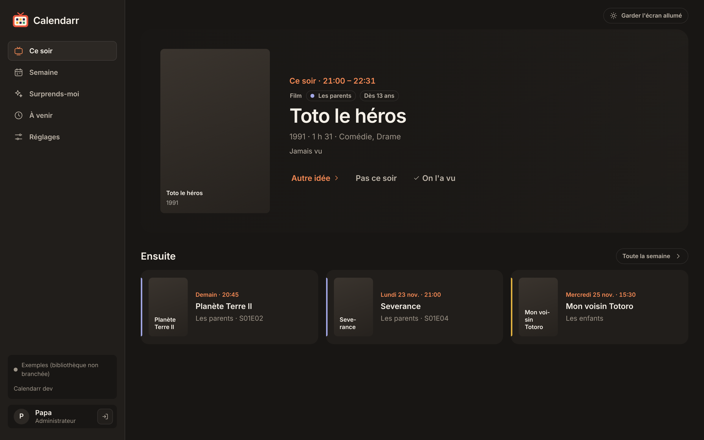
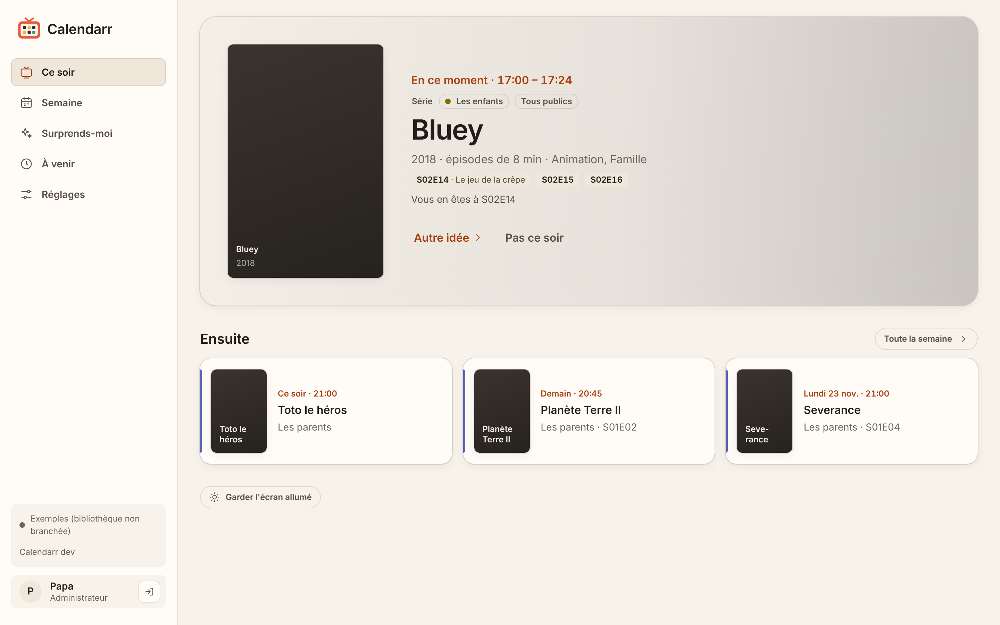
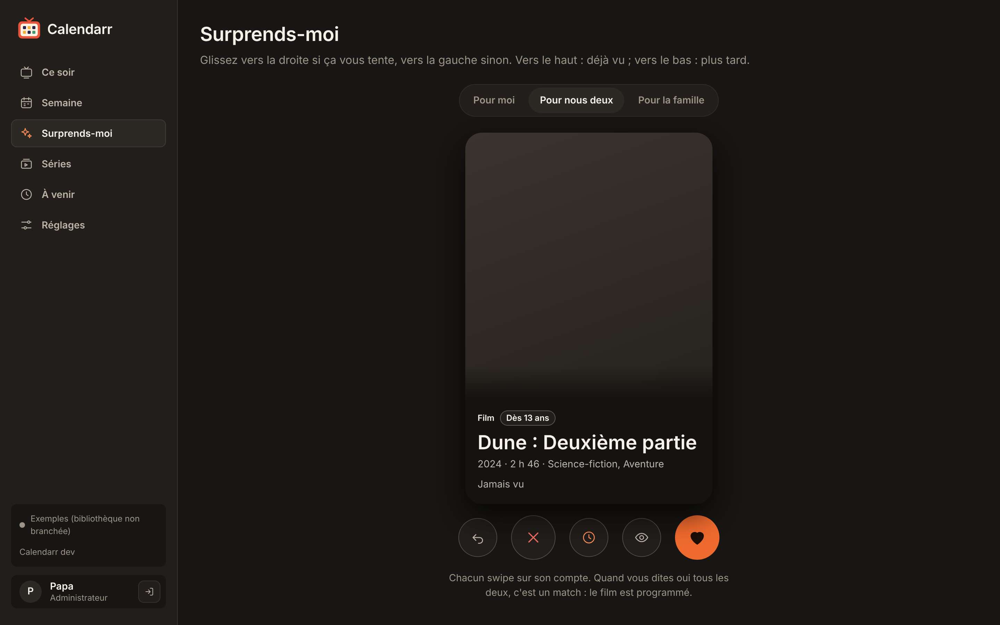
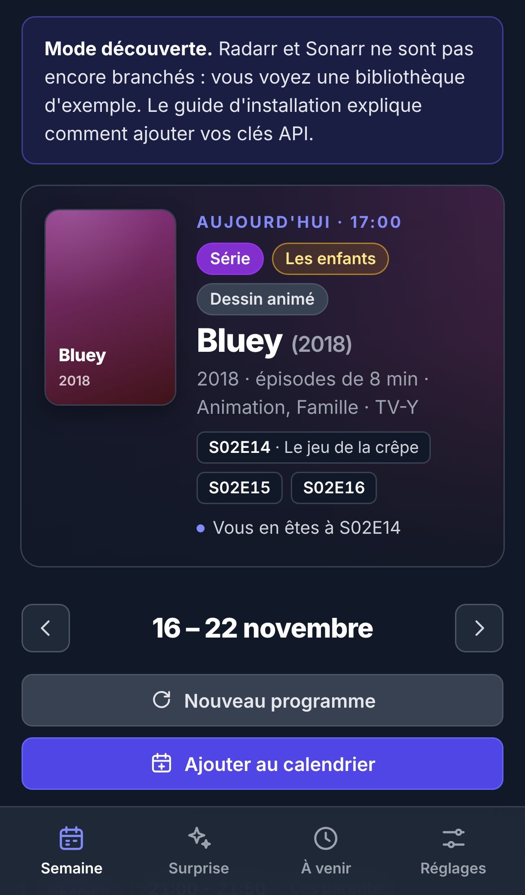
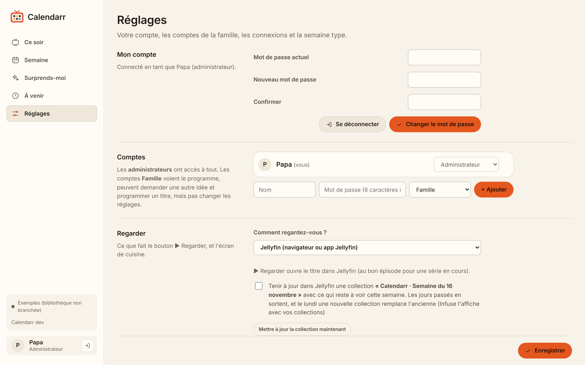

# Calendarr

*[English](README.md) · Français*

Le programme télé de la famille, construit à partir de votre arr stack.

« Qu'est-ce qu'on regarde ce soir ? » Calendarr regarde ce qu'il y a dans votre bibliothèque (Radarr pour
les films, Sonarr pour les séries) et ce que vous avez déjà vu (Jellyfin), puis il prépare le programme
de la semaine. Il tient compte de l'heure à laquelle la soirée peut commencer et de l'âge des enfants, et
le programme s'ajoute à votre calendrier iCloud.

| Sombre | Clair |
|---|---|
|  |  |

L'app suit le réglage clair ou sombre de l'appareil.

## Ce que fait Calendarr

En ouvrant l'app, on tombe sur « Ce soir » : ce qu'on regarde maintenant, en grand, avec trois boutons.
« ▶ Regarder » ouvre le titre dans Jellyfin (au bon épisode pour une série en cours), « Autre idée »
propose autre chose, « Pas ce soir » le retire. Les trois programmes suivants sont juste en dessous.

Pour chaque créneau de votre semaine type, par exemple « mercredi 15 h 30, les enfants, un film de
1 h 30 maximum », Calendarr choisit un titre de la bibliothèque :

- qui tient dans le créneau (pas de film de 2 h 30 un lundi à 21 h) ;
- qui convient au public, d'après la classification du film ou de la série (G, PG, Tous publics, 12…) ;
- jamais vu, ou pas depuis longtemps, d'après l'historique Jellyfin ;
- pour une série, la suite de là où vous en êtes, un ou deux épisodes par soir. Les épisodes très courts,
  comme les dessins animés, sont regroupés.

« Autre idée » ouvre une liste de propositions pour le créneau : on choisit, ou on tire au hasard. Sur
chaque carte, « On l'a vu » coche le film ou les épisodes dans Jellyfin, pour le bon membre de la
famille ; sur un programme à venir, « Déjà vu » écarte le film. Pour un film, la liste des propositions
s'ouvre alors pour choisir quoi regarder à la place. Un jour sans créneau reste une
soirée sans écran. C'est voulu : l'idée est de regarder moins, mais mieux.

« Surprends-moi » propose des cartes à swiper. Vers la droite, le titre est programmé dans le prochain
créneau qui lui convient ; vers la gauche, il ne reviendra plus ; vers le haut, il est marqué vu ; vers
le bas, il reviendra dans deux semaines. Dans la pile « Pour nous deux », chacun swipe sur son compte, et
quand vous dites oui tous les deux, le film est programmé.

« À venir » liste les nouveaux épisodes (Sonarr) et les sorties de films (Radarr) des trois prochaines
semaines. Le programme s'ajoute aussi à l'iPhone, au Mac, à Google Agenda ou à Outlook, avec un rappel
15 minutes avant, et se met à jour tout seul.

L'interface est sobre : fond anthracite chaud (ou crème en mode clair), une seule couleur d'accent, l'heure de chaque programme en colonne.

| Surprends-moi | Sur téléphone |
|---|---|
|  |  |

## Installation

Calendarr est une image Docker (processeurs Intel/AMD et ARM). L'interface Docker de votre NAS suffit, pas
besoin de terminal.

| Image | Usage |
|---|---|
| `ghcr.io/frankless/calendarr:latest` | La dernière version stable, celle à utiliser. |
| `ghcr.io/frankless/calendarr:0.1` | Rester sur la série 0.1. |
| `ghcr.io/frankless/calendarr:edge` | La toute dernière modification, pour tester avant une version. |

Les nouveautés de chaque version sont sur la page [Releases](https://github.com/Frankless/calendarr/releases).

### 1. Créer le projet

Dans l'interface Docker du NAS (UGOS : Docker → Projet → Créer ; Synology : Container Manager → Projet →
Créer ; Portainer : Stacks → Add stack), collez le fichier [`docker-compose.yml`](docker-compose.yml) tel
quel, puis lancez le projet.

### 2. Ouvrir Calendarr

Ouvrez `http://ADRESSE-DU-NAS:7979` dans le navigateur. Au premier lancement, Calendarr demande de créer
le compte administrateur. Faites-le tout de suite : tant que ce compte n'existe pas, n'importe qui sur
votre réseau peut le créer. L'app démarre ensuite avec une bibliothèque d'exemple.

### 3. Brancher Radarr, Sonarr et Jellyfin

Dans Réglages → Connexions, remplissez pour chaque service :

| Champ | Où le trouver |
|---|---|
| Adresse | Celle que vous tapez pour ouvrir le service, par exemple `http://192.168.1.20:7878` pour Radarr, `:8989` pour Sonarr, `:8096` pour Jellyfin |
| Clé API Radarr | Radarr → Settings → General → Security → API Key |
| Clé API Sonarr | Sonarr → Settings → General → Security → API Key |
| Clé API Jellyfin | Jellyfin → Tableau de bord → Clés API → + (appelez-la « Calendarr ») |
| Historique des parents | L'utilisateur Jellyfin dont le « déjà vu » sert pour les créneaux des parents |
| Historique des enfants, de la famille | Facultatif : si les enfants ont leur propre utilisateur Jellyfin, leur « déjà vu » et leur progression dans les séries servent pour leurs créneaux |

« Enregistrer et tester » fait passer les pastilles au vert et refait le programme de la semaine avec
votre vraie bibliothèque.

Si les services tournent sur le même NAS, mettez l'adresse IP du NAS et pas `localhost` : pour Calendarr,
`localhost` désigne son propre conteneur.

Les clés restent sur le NAS, dans le dossier `config` du projet (fichier `connections.json`), avec vos
réglages et vos programmes. L'app n'affiche jamais une clé en entier. Pour en changer, collez la nouvelle ;
un champ laissé vide garde l'ancienne.

### 4. Les comptes de la famille

Dans Réglages → Comptes, l'administrateur crée un compte par personne. Chacun reste connecté 30 jours sur
son appareil.

| Rôle | Ce qu'il peut faire |
|---|---|
| Administrateur | Tout : connexions, comptes, famille, semaine type. |
| Famille | Voir le programme, demander une autre idée, retirer ou programmer un titre, voir les sorties à venir, changer son mot de passe. |

Chacun change son mot de passe dans « Mon compte », et l'administrateur peut en donner un nouveau à
quelqu'un qui l'a oublié. Changer un mot de passe déconnecte les autres appareils du compte.

Si c'est le mot de passe administrateur qui est perdu : arrêtez le projet, supprimez `config/users.json`,
relancez. Calendarr redemande de créer le compte administrateur, et les réglages, connexions et programmes
restent en place.

### Avec un terminal

```bash
mkdir calendarr && cd calendarr
curl -O https://raw.githubusercontent.com/Frankless/calendarr/main/docker-compose.yml
docker compose up -d
```

### Dans le docker-compose de votre arr stack

Copiez le bloc `calendarr:` du fichier `docker-compose.yml` sous `services:`. Si Calendarr est sur le même
réseau Docker que les autres services, les adresses peuvent utiliser le nom des conteneurs, par exemple
`http://radarr:7878`.

Les variables `RADARR_URL`, `RADARR_API_KEY`, `SONARR_URL`, `SONARR_API_KEY`, `JELLYFIN_URL`,
`JELLYFIN_API_KEY` et `JELLYFIN_USER` marchent aussi, mais ce qui est saisi dans l'app passe avant.

## Sur l'iPhone et l'iPad

Dans Safari, ouvrez Calendarr, touchez Partager, puis « Sur l'écran d'accueil ». Calendarr s'ouvre ensuite
en plein écran, comme une app. Sur un iPad posé dans la cuisine, « Garder l'écran allumé » (page Ce soir)
l'empêche de se mettre en veille.

Pour que « ▶ Regarder » marche depuis le téléphone, l'adresse de Jellyfin doit être joignable depuis le
téléphone. Si celle de Réglages → Connexions ne vaut que pour le NAS (`http://jellyfin:8096` par exemple),
remplissez aussi « Adresse pour ouvrir Jellyfin depuis le téléphone ou l'iPad ».

## Infuse sur l'Apple TV

Dans Réglages → Regarder, choisissez comment la famille regarde :

| Choix | Ce que fait le bouton |
|---|---|
| Jellyfin | « ▶ Regarder » ouvre le titre dans Jellyfin. |
| Infuse sur le téléphone ou l'iPad | « ▶ Regarder » ouvre Infuse sur l'appareil, au bon film ou au bon épisode (à vérifier avec votre version d'Infuse). |
| Infuse sur l'Apple TV | Une page web ne peut pas lancer un film sur l'Apple TV. Le bouton devient « Sur l'Apple TV » et indique où trouver le titre dans Infuse, avec l'épisode à lancer. |

Avec l'option « Tenir à jour une collection de la semaine », Calendarr crée dans Jellyfin une collection
« Calendarr · Semaine du 23 novembre » avec ce qui reste à voir cette semaine. Les jours passés en sortent,
et le lundi la nouvelle collection remplace l'ancienne. Seule la collection est supprimée, jamais les
films. Il n'y a donc jamais qu'une collection Calendarr à la fois ; évitez juste de nommer vous-même une
collection « Calendarr · … ». Si Infuse est relié à votre Jellyfin, la collection apparaît dans Infuse
avec les autres.

## Écran de cuisine

Réglages → Regarder donne aussi le lien de l'écran de cuisine. Ouvert sur une tablette murale, un écran
d'assistant ou une télé, il affiche l'heure, « Ce soir » en grand et la suite, et se met à jour tout seul,
en paysage comme en portrait. Il ne demande pas de connexion et ne permet de rien modifier. Le lien
contient une clé secrète : si vous ne savez plus où il traîne, créez-en un nouveau, l'ancien cessera de
marcher.

## Le programme dans le calendrier de l'iPhone

1. Sur l'iPhone, connecté au Wi-Fi de la maison, ouvrez Calendarr.
2. Touchez « Ajouter à mon calendrier », puis « S'abonner sur cet appareil ».
3. Confirmez. Le programme apparaît dans l'app Calendrier, avec un rappel 15 minutes avant.

Faites de même sur le téléphone des autres membres de la famille.

L'iPhone met le calendrier à jour lui-même, mais seulement quand il est à la maison. Pour qu'il se mette
à jour ailleurs, ou pour l'ajouter depuis un Mac « dans iCloud », Calendarr doit être joignable depuis
Internet. Le plus simple et le plus sûr est Tailscale, une app à installer sur le NAS et sur les
téléphones. Si vous avez déjà un reverse proxy pour Jellyfin (Nginx Proxy Manager, Traefik, Caddy…),
il fait aussi l'affaire : ajoutez alors `PUBLIC_URL: https://votre-adresse` dans la partie
`environment:` du projet Docker.

## Régler la semaine type



Réglages permet de changer :

- l'âge des enfants et l'âge conseillé maximum, 8 ans pour les soirées en famille et 6 pour les créneaux
  enfants (à 7, un film « PG » passe, un « PG-13 » non) ;
- le nombre d'épisodes par soirée, le délai avant de revoir un film, et le rappel ;
- les genres aimés ou à éviter (touchez un genre une fois pour l'aimer, deux fois pour l'éviter) ;
- la semaine type : pour chaque jour, des créneaux avec une heure, une durée maximum, un public (enfants,
  famille, parents), un type (film, série, documentaire, peu importe) et un nom.

La semaine type de départ :

| Jour | Créneau |
|---|---|
| Lundi | 21 h, série pour les parents (60 min) |
| Mardi | soirée sans écran |
| Mercredi | 15 h 30, film pour les enfants (1 h 30) |
| Jeudi | 21 h, « la grande première », film pour les parents (2 h 15) |
| Vendredi | 18 h 30, film familial (1 h 45) |
| Samedi | 17 h, dessin animé ; 21 h, soirée ciné (2 h 30) |
| Dimanche | 20 h 45, documentaire (60 min) |

Après un changement, « Enregistrer » refait la semaine suivante. Pour la semaine en cours, utilisez
« Nouveau programme ».

## Mettre à jour

Dans l'interface Docker du NAS, arrêtez le projet, mettez l'image à jour (« Pull » ou « Mettre à jour »),
puis relancez-le. En terminal : `docker compose pull && docker compose up -d`. L'image `latest` ne change
qu'à la sortie d'une nouvelle version. Vos réglages et programmes restent dans le dossier `config/`.

## En cas de souci

| Problème | Solution |
|---|---|
| Pastille rouge « Injoignable » | L'adresse est fausse, ou le conteneur ne voit pas l'autre service. Essayez l'adresse IP du NAS plutôt que `localhost`. |
| « Clé API refusée » | Recopiez la clé, sans espace au début ni à la fin. |
| « Rien ne correspond » sur un créneau | Le créneau est trop court, l'âge maximum trop bas, ou tout a déjà été vu. Élargissez le créneau dans Réglages. |
| Le NAS refuse de télécharger l'image (« unauthorized ») | Sur GitHub, ouvrez le paquet `calendarr` (onglet Packages de votre profil), puis Package settings → Change visibility → Public. |
| Comprendre ce qui se passe | Le journal (« Logs ») du conteneur dans l'interface Docker, ou `docker logs calendarr`. |

## Sécurité

Les mots de passe font au moins 8 caractères et ne sont jamais stockés en clair. Après 5 erreurs depuis
un même appareil, ou 20 sur un même compte, il faut attendre 5 minutes.

Les clés API restent sur le NAS et ne repartent jamais en entier vers le navigateur. Si l'adresse d'un
service change, sa clé est effacée et doit être saisie à nouveau, pour qu'elle ne parte jamais vers une
autre adresse.

Dans le conteneur, Calendarr ne tourne pas en root mais avec l'utilisateur `1000:1000`. Pour en choisir
un autre, ajoutez `PUID` et `PGID` dans la partie `environment:` du projet.

Derrière un reverse proxy, ajoutez `FORWARDED_ALLOW_IPS: <adresse IP du proxy>` dans `environment:`,
pour que Calendarr voie l'adresse réelle des visiteurs. Sans proxy, n'ajoutez rien. Et ne publiez pas
Calendarr sur Internet sans HTTPS ; Tailscale reste le plus simple.

Pour signaler un problème de sécurité, ouvrez une issue sans détails techniques, ou contactez le
propriétaire du dépôt.

## Publier une nouvelle version

Sur GitHub, onglet Actions → Image Docker → Run workflow, saisissez le numéro (par exemple `0.2.0`) et
validez. Quelques minutes plus tard, l'image `latest` est à jour et la version apparaît dans Releases. Les
notes de version se préparent dans `docs/releases/v0.2.0.md`.

Les idées en cours et à venir sont dans [docs/backlog.md](docs/backlog.md) (en anglais).

## Sous le capot

- `app/clients.py` parle aux API de Radarr, Sonarr et Jellyfin.
- `app/planner.py` contient les règles qui choisissent quoi regarder.
- `app/feedback.py` garde en mémoire les choix faits dans « Surprends-moi ».
- `app/ics.py` fabrique le calendrier.
- `app/static/` contient l'interface : HTML, CSS et JavaScript, sans framework, avec la police du système.

Le tout tourne en Python 3.12 avec FastAPI, dans une seule image Docker.
