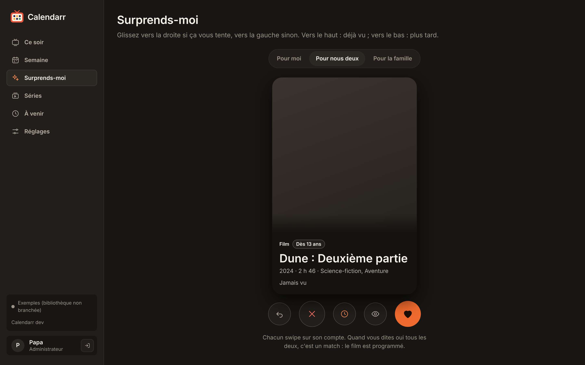

# Calendarr

**Le programme télé de la famille, construit à partir de votre arr stack.**

« Qu'est-ce qu'on regarde ce soir ? » Calendarr répond à votre place. Il regarde ce qu'il y a dans
votre bibliothèque (Radarr pour les films, Sonarr pour les séries), ce que vous avez déjà vu
(Jellyfin), et il prépare un programme pour la semaine. Le programme tient compte de l'heure à laquelle
la soirée peut commencer et de l'âge des enfants. Il s'ajoute ensuite à votre calendrier iCloud.


## Ce que fait Calendarr

- **Ce soir** : en ouvrant l'app, on voit tout de suite ce qu'on regarde maintenant, en grand, avec
  trois boutons : **▶ Regarder** (ouvre le titre dans Jellyfin, au bon épisode pour une série en cours),
  **Autre idée** et **Pas ce soir**. En dessous, les trois programmes suivants.

- **Un programme pour chaque semaine.** Pour chaque créneau de votre semaine type (par exemple « mercredi
  15 h 30, les enfants, un film de 1 h 30 maximum »), Calendarr choisit un titre de votre bibliothèque :
  - le titre **tient dans le créneau** : pas de film de 2 h 30 un lundi à 21 h ;
  - il **convient au public** : Calendarr lit la classification (G, PG, Tous publics, 12…) ;
  - il **n'a jamais été vu**, ou pas depuis longtemps (historique Jellyfin) ;
  - pour une série, Calendarr **reprend là où vous en êtes** et propose un ou deux épisodes, pas plus.
    Les épisodes très courts, comme les dessins animés, sont regroupés.
- **« Autre idée »** sur chaque créneau, si la proposition ne vous tente pas.
- **Les soirées sans écran** : un jour sans créneau reste libre. Le but est d'éviter la surconsommation.
- **Surprends-moi** : trois rangées d'idées (pour moi, pour nous deux, pour la famille). Un titre vous
  plaît ? Vous le programmez en deux clics.
- **À venir** : les nouveaux épisodes (Sonarr) et les sorties de films (Radarr) des trois prochaines semaines.
- **Le calendrier** : un lien d'abonnement pour iPhone, Mac, Google Agenda ou Outlook, avec un rappel
  15 minutes avant. Il se met à jour tout seul.

L'interface reprend l'esthétique des apps de l'écosystème *arr et de Seerr : thème sombre, accent
indigo, menu latéral, jaquettes avec badges.

| Surprends-moi | Sur téléphone |
|---|---|
|  |  |

## Installation

Calendarr est publié sous forme d'image Docker prête à l'emploi (processeurs Intel/AMD et ARM). Pas
besoin de terminal : l'interface Docker de votre NAS suffit.

| Image | Pour qui |
|---|---|
| `ghcr.io/frankless/calendarr:latest` | La dernière version stable. **C'est celle à utiliser.** |
| `ghcr.io/frankless/calendarr:0.1` | Rester sur la série 0.1 (corrections seulement). |
| `ghcr.io/frankless/calendarr:edge` | La toute dernière modification, pour tester avant une version. |

Les nouveautés de chaque version sont sur la page
[Releases](https://github.com/Frankless/calendarr/releases).

### 1. Créer le projet

Dans l'interface Docker de votre NAS (UGOS : **Docker → Projet → Créer**, Synology : **Container Manager →
Projet → Créer**, Portainer : **Stacks → Add stack**), collez le contenu du fichier
[`docker-compose.yml`](docker-compose.yml) **tel quel**, puis lancez le projet.

### 2. Ouvrir Calendarr

Ouvrez **http://ADRESSE-DU-NAS:7979** dans votre navigateur. Calendarr démarre en **mode découverte**,
avec une bibliothèque d'exemple.

### 3. Brancher Radarr, Sonarr et Jellyfin

Dans **Réglages → Connexions**, remplissez pour chaque service :

| Champ | Où le trouver |
|---|---|
| Adresse | Celle que vous tapez pour ouvrir le service, par exemple `http://192.168.1.20:7878` pour Radarr, `:8989` pour Sonarr, `:8096` pour Jellyfin |
| Clé API Radarr | Radarr → **Settings → General → Security → API Key** |
| Clé API Sonarr | Sonarr → **Settings → General → Security → API Key** |
| Clé API Jellyfin | Jellyfin → **Tableau de bord → Clés API → +** (nommez-la « Calendarr ») |
| Utilisateur Jellyfin | Choisi dans la liste une fois la clé enregistrée : son historique sert pour le « déjà vu » |

Cliquez **Enregistrer et tester** : les pastilles passent au vert, et le programme de la semaine est
refait avec votre vraie bibliothèque.

Si Radarr, Sonarr et Jellyfin tournent sur le même NAS, utilisez **l'adresse IP du NAS**, pas
`localhost` : pour Calendarr, `localhost` désigne son propre conteneur.

Les clés sont enregistrées sur le NAS, dans le dossier `config` du projet (fichier `connections.json`),
avec vos réglages et vos programmes. L'app n'affiche jamais une clé en entier : pour en changer, collez la
nouvelle ; laissez le champ vide pour garder l'ancienne.

### 4. Les comptes

Au tout premier lancement, Calendarr demande de **créer le compte administrateur** (nom et mot de passe).
Ensuite, chaque personne se connecte avec son propre compte, et reste connectée 30 jours sur son appareil.

Dans **Réglages → Comptes**, l'administrateur ajoute un compte par membre de la famille :

| Rôle | Ce qu'il peut faire |
|---|---|
| **Administrateur** | Tout : connexions, comptes, famille, semaine type. |
| **Famille** | Voir le programme, demander une autre idée, retirer ou programmer un titre, voir les sorties à venir, changer son propre mot de passe. |

Chacun change son mot de passe dans **Mon compte**. L'administrateur peut aussi donner un nouveau mot de
passe à quelqu'un qui l'a oublié. Changer un mot de passe déconnecte les autres appareils de ce compte.

Le lien d'abonnement au calendrier (iPhone) fonctionne sans se connecter : il est protégé par sa propre
clé secrète.

**Mot de passe administrateur oublié ?** Arrêtez le projet, supprimez le fichier `config/users.json` du
projet, puis relancez : Calendarr redemande de créer le compte administrateur. Les réglages, les
connexions et les programmes sont conservés.

### Avec un terminal

```bash
mkdir calendarr && cd calendarr
curl -O https://raw.githubusercontent.com/Frankless/calendarr/main/docker-compose.yml
docker compose up -d
```

### Ou : l'ajouter au docker-compose de votre arr stack

Copiez le bloc `calendarr:` du fichier `docker-compose.yml` sous `services:`. Si Calendarr est sur le
même réseau Docker que vos autres services, vous pouvez utiliser les noms des conteneurs dans les
adresses, par exemple `http://radarr:7878`.

> Pour les habitués : les variables `RADARR_URL`, `RADARR_API_KEY`, `SONARR_URL`, `SONARR_API_KEY`,
> `JELLYFIN_URL`, `JELLYFIN_API_KEY` et `JELLYFIN_USER` fonctionnent aussi. Ce qui est saisi dans l'app
> passe avant.

## Installer Calendarr comme une app (iPhone, iPad)

Dans Safari, ouvrez Calendarr, touchez **Partager**, puis **Sur l'écran d'accueil**. Calendarr s'ouvre
ensuite comme une vraie app, en plein écran, sans la barre de Safari. Sur un iPad posé dans la cuisine,
le bouton **Garder l'écran allumé** (page Ce soir) empêche l'écran de se mettre en veille.

Pour que **▶ Regarder** fonctionne depuis le téléphone, l'adresse de Jellyfin doit être joignable depuis
celui-ci. Si l'adresse saisie dans Réglages → Connexions n'est valable que pour le NAS (par exemple
`http://jellyfin:8096`), remplissez aussi le champ **Adresse pour ouvrir Jellyfin depuis le téléphone ou
l'iPad**.

## Regarder avec Infuse sur l'Apple TV

Dans **Réglages → Regarder**, choisissez comment la famille regarde :

| Choix | Ce que fait le bouton |
|---|---|
| Jellyfin | **▶ Regarder** ouvre le titre dans Jellyfin. |
| Infuse sur le téléphone ou l'iPad | **▶ Regarder** ouvre Infuse sur l'appareil, au bon film ou au bon épisode (à tester avec votre version d'Infuse). |
| Infuse sur l'Apple TV | Une page web ne peut pas lancer un film sur l'Apple TV : le bouton devient **Sur l'Apple TV** et rappelle où trouver le titre dans Infuse, avec l'épisode à lancer. |

Cochez **Tenir à jour une collection de la semaine** : Calendarr crée dans Jellyfin une collection
« Calendarr · Semaine du 23 novembre » avec ce qui reste à voir cette semaine. Les jours passés en
sortent, et le lundi une nouvelle collection remplace l'ancienne (seule la collection est supprimée,
jamais les films). Si Infuse est
relié à votre Jellyfin, la collection apparaît dans Infuse sur l'Apple TV, avec vos autres collections.

## Écran de cuisine

Dans **Réglages → Regarder**, copiez le lien de l'**écran de cuisine** et ouvrez-le sur une tablette
murale, un écran d'assistant, une vieille tablette ou une télé. Il affiche l'heure, « Ce soir » en grand
et la suite, se met à jour tout seul, et s'adapte à toutes les tailles (paysage ou portrait). Il ne
demande pas de connexion et ne permet rien modifier. Le lien contient une clé secrète : si vous le
perdez de vue, créez-en un nouveau, l'ancien cessera de fonctionner.

## Ajouter le programme à l'iPhone (iCloud)

1. Sur l'iPhone, **connecté au Wi-Fi de la maison**, ouvrez Calendarr.
2. Touchez **Ajouter à mon calendrier**, puis **S'abonner sur cet appareil**.
3. Confirmez. Le programme apparaît dans l'app Calendrier, avec un rappel 15 minutes avant.

Pour votre épouse, faites la même chose sur son téléphone.

**Bon à savoir :** l'iPhone met le calendrier à jour lui-même, quand il est à la maison. Pour qu'il se
mette aussi à jour à l'extérieur, ou pour l'ajouter depuis un Mac « dans iCloud », Calendarr doit être
joignable depuis Internet. Deux solutions :

- **Tailscale** (le plus simple et le plus sûr) : une app à installer sur le serveur et sur les téléphones.
- Un **reverse proxy** (Nginx Proxy Manager, Traefik, Caddy…), si vous en avez déjà un pour Jellyfin.
  Dans ce cas, ajoutez `PUBLIC_URL: https://votre-adresse` dans la partie `environment:` du projet Docker.

Le lien du calendrier contient une clé secrète. L'interface est protégée par les comptes. Si vous l'ouvrez sur Internet, passez par
un reverse proxy en HTTPS (ou Tailscale), et choisissez des mots de passe solides.

## Régler la semaine type


Dans **Réglages**, vous pouvez changer :

- **L'âge des enfants** et l'âge conseillé maximum : 8 pour les soirées en famille, 6 pour les créneaux
  enfants. Avec 7, un film « PG » passe, un « PG-13 » non.
- **Le rythme** : le nombre d'épisodes maximum par soirée, après combien d'années on peut revoir un film,
  et le rappel.
- **Les goûts** : touchez un genre une fois pour l'aimer, deux fois pour l'éviter.
- **La semaine type** : pour chaque jour, des créneaux avec une heure, une durée maximum, un public
  (enfants, famille, parents), un type (film, série, documentaire, peu importe) et un nom.

La semaine type proposée au départ :

| Jour | Créneau |
|---|---|
| Lundi | 21 h, série pour les parents (60 min) |
| Mardi | soirée sans écran |
| Mercredi | 15 h 30, film pour les enfants (1 h 30) |
| Jeudi | 21 h, « la grande première », film pour les parents (2 h 15) |
| Vendredi | 18 h 30, film familial (1 h 45) |
| Samedi | 17 h, dessin animé · 21 h, soirée ciné (2 h 30) |
| Dimanche | 20 h 45, documentaire (60 min) |

Après un changement, cliquez **Enregistrer**. La semaine suivante est refaite automatiquement. Pour la
semaine en cours, utilisez **Nouveau programme**.

## Mettre à jour Calendarr

Une nouvelle image est publiée à chaque modification du dépôt. Pour la récupérer : dans l'interface
Docker du NAS, **arrêtez le projet, mettez l'image à jour (« Pull » / « Mettre à jour »), puis relancez-le**.
En terminal : `docker compose pull && docker compose up -d`.

Vos réglages et vos programmes sont gardés dans le dossier `config/`.

## En cas de souci

| Problème | Solution |
|---|---|
| Pastille rouge « Injoignable » | L'adresse est fausse, ou le conteneur ne voit pas l'autre service. Essayez l'adresse IP du serveur plutôt que `localhost`. |
| « Clé API refusée » | Recopiez la clé, sans espace au début ni à la fin. |
| « Rien ne correspond » sur un créneau | La durée maximum est trop courte, ou l'âge maximum trop bas, ou tout a déjà été vu. Élargissez le créneau dans les Réglages. |
| Le NAS refuse de télécharger l'image (« unauthorized ») | Sur GitHub, ouvrez le paquet `calendarr` (onglet **Packages** de votre profil) → **Package settings** → **Change visibility** → **Public**. |
| Voir ce qui se passe | Le journal (« Logs ») du conteneur dans l'interface Docker, ou `docker logs calendarr` |

## Sécurité

- **Créez le compte administrateur tout de suite après l'installation** : tant qu'il n'existe pas, la
  première personne qui ouvre Calendarr sur votre réseau peut le créer.
- Mots de passe de 8 caractères minimum, chiffrés de façon irréversible. Après 5 erreurs depuis un même
  appareil, ou 20 sur un même compte, il faut attendre 5 minutes.
- Les clés API restent sur le NAS et ne sont jamais renvoyées en entier au navigateur. Si l'adresse d'un
  service change, sa clé doit être saisie à nouveau : elle n'est jamais envoyée à une autre adresse.
- Dans le conteneur, Calendarr ne tourne pas en root. Par défaut, il utilise l'utilisateur `1000:1000` ;
  pour en choisir un autre, ajoutez `PUID` et `PGID` dans la partie `environment:` du projet.
- **Derrière un reverse proxy** (Nginx Proxy Manager, Traefik, Caddy…), ajoutez
  `FORWARDED_ALLOW_IPS: <adresse IP du proxy>` dans `environment:`, pour que Calendarr voie l'adresse réelle
  des visiteurs. Sans proxy, ne mettez rien.
- Ne publiez pas Calendarr sur Internet sans HTTPS ; Tailscale reste la solution la plus simple.
- Vous avez trouvé un problème de sécurité ? Ouvrez une issue sans détail public, ou contactez le
  propriétaire du dépôt.

## Et ensuite ?

Les idées et leur avancement sont dans [docs/backlog.md](docs/backlog.md).

## Pour les curieux : comment c'est fait

- `app/clients.py` : la connexion aux API de Radarr, Sonarr et Jellyfin.
- `app/planner.py` : les règles qui choisissent quoi regarder.
- `app/ics.py` : la fabrication du calendrier.
- `app/static/` : l'interface (HTML, CSS et JavaScript, sans framework). Police Inter, chargée depuis
  Google Fonts quand Internet est disponible.
- Python 3.12 et FastAPI, dans une seule image Docker.
