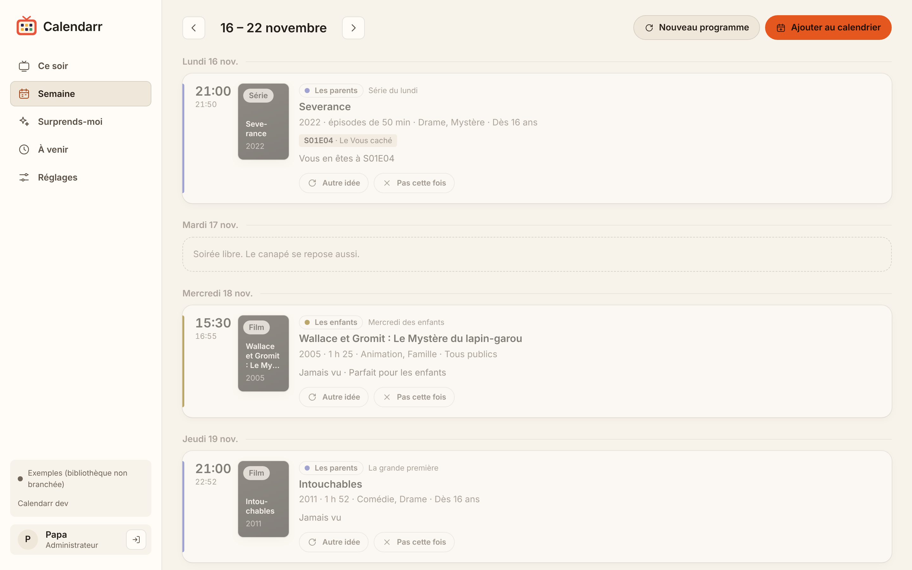

# Calendarr

**Le programme télé de la famille, construit à partir de votre arr stack.**

« Qu'est-ce qu'on regarde ce soir ? » Calendarr répond à votre place. Il regarde ce qu'il y a dans
votre bibliothèque (Radarr pour les films, Sonarr pour les séries), ce que vous avez déjà vu
(Jellyfin), et il prépare un programme pour la semaine. Le programme tient compte de l'heure à laquelle
la soirée peut commencer et de l'âge des enfants. Il s'ajoute ensuite à votre calendrier iCloud.



## Ce que fait Calendarr

- **Un programme pour chaque semaine.** Pour chaque créneau de votre semaine type (par exemple « mercredi
  15 h 30, les enfants, un film de 1 h 30 maximum »), Calendarr choisit un titre de votre bibliothèque :
  - le titre **tient dans le créneau** : pas de film de 2 h 30 un lundi à 21 h ;
  - il **convient au public** : Calendarr lit la classification (G, PG, Tous publics, 12…) ;
  - il **n'a jamais été vu**, ou pas depuis longtemps (historique Jellyfin) ;
  - pour une série, Calendarr **reprend là où vous en êtes** et propose un ou deux épisodes, pas plus.
    Les épisodes très courts, comme les dessins animés, sont regroupés.
- **« Autre idée »** sur chaque créneau, si la proposition ne vous tente pas.
- **Les soirées sans écran** : un jour sans créneau reste libre. Le but est d'éviter la surconsommation.
- **Surprends-moi** : trois rangées d'idées (pour moi, pour nous deux, pour la famille). Un titre vous
  plaît ? Vous le programmez en deux clics.
- **À venir** : les nouveaux épisodes (Sonarr) et les sorties de films (Radarr) des trois prochaines semaines.
- **Le calendrier** : un lien d'abonnement pour iPhone, Mac, Google Agenda ou Outlook, avec un rappel
  15 minutes avant. Il se met à jour tout seul.

L'interface reprend l'esthétique des apps de l'écosystème *arr et de Seerr : thème sombre, accent
indigo, menu latéral, jaquettes avec badges.

| Surprends-moi | Sur téléphone |
|---|---|
|  |  |

## Installation

Calendarr est publié sous forme d'image Docker prête à l'emploi : `ghcr.io/frankless/calendarr:latest`
(processeurs Intel/AMD et ARM). Pas besoin de terminal : l'interface Docker de votre NAS suffit.

### 1. Créer le projet

Dans l'interface Docker de votre NAS (UGOS : **Docker → Projet → Créer**, Synology : **Container Manager →
Projet → Créer**, Portainer : **Stacks → Add stack**), collez le contenu du fichier
[`docker-compose.yml`](docker-compose.yml).

### 2. Renseigner les adresses et les clés API

Dans ce même texte, remplissez les lignes de la partie `environment:` :

| Ligne | Où la trouver |
|---|---|
| `RADARR_URL` | L'adresse que vous tapez pour ouvrir Radarr, par exemple `http://192.168.1.20:7878` |
| `RADARR_API_KEY` | Radarr → **Settings → General → Security → API Key** |
| `SONARR_URL` | Pareil pour Sonarr, par exemple `http://192.168.1.20:8989` |
| `SONARR_API_KEY` | Sonarr → **Settings → General → Security → API Key** |
| `JELLYFIN_URL` | Par exemple `http://192.168.1.20:8096` |
| `JELLYFIN_API_KEY` | Jellyfin → **Tableau de bord → Clés API → +** (nommez-la « Calendarr ») |
| `JELLYFIN_USER` | Votre nom d'utilisateur Jellyfin (son historique sert pour le « déjà vu ») |

Si Radarr, Sonarr et Jellyfin tournent sur le même NAS, utilisez **l'adresse IP du NAS**, pas
`localhost` : pour Calendarr, `localhost` désigne son propre conteneur.

> 💡 Laissez les clés vides pour démarrer en **mode découverte**, avec une bibliothèque d'exemple. C'est
> pratique pour essayer l'interface.

### 3. Démarrer

Lancez le projet. Ouvrez ensuite **http://ADRESSE-DU-NAS:7979** dans votre navigateur. Dans l'onglet
**Réglages**, les trois pastilles Radarr, Sonarr et Jellyfin doivent être vertes.

Les réglages et les programmes sont gardés dans le dossier `config` du projet (monté sur `/config`).

### Avec un terminal

```bash
mkdir calendarr && cd calendarr
curl -O https://raw.githubusercontent.com/Frankless/calendarr/main/docker-compose.yml
nano docker-compose.yml     # remplir les adresses et les clés API
docker compose up -d
```

### Ou : l'ajouter au docker-compose de votre arr stack

Copiez le bloc `calendarr:` du fichier `docker-compose.yml` sous `services:`. Si Calendarr est sur le
même réseau Docker que vos autres services, vous pouvez utiliser les noms des conteneurs, par exemple
`RADARR_URL: http://radarr:7878`.

## Ajouter le programme à l'iPhone (iCloud)

1. Sur l'iPhone, **connecté au Wi-Fi de la maison**, ouvrez Calendarr.
2. Touchez **Ajouter à mon calendrier**, puis **S'abonner sur cet appareil**.
3. Confirmez. Le programme apparaît dans l'app Calendrier, avec un rappel 15 minutes avant.

Pour votre épouse, faites la même chose sur son téléphone.

**Bon à savoir :** l'iPhone met le calendrier à jour lui-même, quand il est à la maison. Pour qu'il se
mette aussi à jour à l'extérieur, ou pour l'ajouter depuis un Mac « dans iCloud », Calendarr doit être
joignable depuis Internet. Deux solutions :

- **Tailscale** (le plus simple et le plus sûr) : une app à installer sur le serveur et sur les téléphones.
- Un **reverse proxy** (Nginx Proxy Manager, Traefik, Caddy…), si vous en avez déjà un pour Jellyfin.
  Dans ce cas, renseignez `PUBLIC_URL` dans le projet Docker.

Le lien du calendrier contient une clé secrète. Seul ce lien est lisible sans mot de passe. Par contre,
**l'interface elle-même n'a pas de mot de passe** : ne l'exposez pas sur Internet sans protection
(Tailscale, ou l'authentification de votre reverse proxy).

## Régler la semaine type


Dans **Réglages**, vous pouvez changer :

- **L'âge des enfants** et l'âge conseillé maximum : 8 pour les soirées en famille, 6 pour les créneaux
  enfants. Avec 7, un film « PG » passe, un « PG-13 » non.
- **Le rythme** : le nombre d'épisodes maximum par soirée, après combien d'années on peut revoir un film,
  et le rappel.
- **Les goûts** : touchez un genre une fois pour l'aimer, deux fois pour l'éviter.
- **La semaine type** : pour chaque jour, des créneaux avec une heure, une durée maximum, un public
  (enfants, famille, parents), un type (film, série, documentaire, peu importe) et un nom.

La semaine type proposée au départ :

| Jour | Créneau |
|---|---|
| Lundi | 21 h, série pour les parents (60 min) |
| Mardi | soirée sans écran |
| Mercredi | 15 h 30, film pour les enfants (1 h 30) |
| Jeudi | 21 h, « la grande première », film pour les parents (2 h 15) |
| Vendredi | 18 h 30, film familial (1 h 45) |
| Samedi | 17 h, dessin animé · 21 h, soirée ciné (2 h 30) |
| Dimanche | 20 h 45, documentaire (60 min) |

Après un changement, cliquez **Enregistrer**. La semaine suivante est refaite automatiquement. Pour la
semaine en cours, utilisez **Nouveau programme**.

## Mettre à jour Calendarr

Une nouvelle image est publiée à chaque modification du dépôt. Pour la récupérer : dans l'interface
Docker du NAS, **arrêtez le projet, mettez l'image à jour (« Pull » / « Mettre à jour »), puis relancez-le**.
En terminal : `docker compose pull && docker compose up -d`.

Vos réglages et vos programmes sont gardés dans le dossier `config/`.

## En cas de souci

| Problème | Solution |
|---|---|
| Pastille rouge « Injoignable » | L'adresse est fausse, ou le conteneur ne voit pas l'autre service. Essayez l'adresse IP du serveur plutôt que `localhost`. |
| « Clé API refusée » | Recopiez la clé, sans espace au début ni à la fin. |
| « Rien ne correspond » sur un créneau | La durée maximum est trop courte, ou l'âge maximum trop bas, ou tout a déjà été vu. Élargissez le créneau dans les Réglages. |
| Après avoir modifié une adresse ou une clé | Relancez le projet pour qu'elle soit prise en compte. |
| Le NAS refuse de télécharger l'image (« unauthorized ») | Sur GitHub, ouvrez le paquet `calendarr` (onglet **Packages** de votre profil) → **Package settings** → **Change visibility** → **Public**. |
| Voir ce qui se passe | Le journal (« Logs ») du conteneur dans l'interface Docker, ou `docker logs calendarr` |

## Pour les curieux : comment c'est fait

- `app/clients.py` : la connexion aux API de Radarr, Sonarr et Jellyfin.
- `app/planner.py` : les règles qui choisissent quoi regarder.
- `app/ics.py` : la fabrication du calendrier.
- `app/static/` : l'interface (HTML, CSS et JavaScript, sans framework). Police Inter, chargée depuis
  Google Fonts quand Internet est disponible.
- Python 3.12 et FastAPI, dans une seule image Docker.
