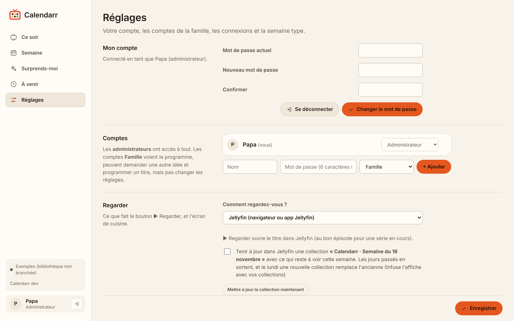

# Calendarr

*English · [Français](README.fr.md)*

A family TV schedule built from your *arr stack.

"What are we watching tonight?" Calendarr looks at what is in your library (Radarr for movies, Sonarr for
series) and at what you have already watched (Jellyfin), then plans the week. It takes into account when
the evening can start and how old the kids are, and the schedule shows up in your iCloud calendar.

The app itself is in French: it was made for a French-speaking family. Labels quoted below are the ones
you will see on screen, with a translation.

| Dark | Light |
|---|---|
|  |  |

The app follows the light or dark setting of the device.

## What it does

The app opens on "Ce soir" (Tonight): what's on now, in large, with three buttons. "▶ Regarder" (Watch)
opens the title in Jellyfin, at the right episode for a series in progress. "Autre idée" (Another idea)
suggests something else. "Pas ce soir" (Not tonight) removes it. The next three programs sit right below.

For each slot of your typical week, for example "Wednesday 3:30 pm, the kids, a movie of 1 h 30 at most",
Calendarr picks a title from the library that:

- fits in the slot (no 2 h 30 movie on a Monday at 9 pm);
- suits the audience, based on the movie or series rating (G, PG, Tous publics, 12…);
- has never been watched, or not for a long time, according to Jellyfin;
- for a series, continues where you left off, one or two episodes per evening. Very short episodes, such
  as cartoons, are grouped.

Nothing is scheduled until the family chooses it. What Calendarr proposes is an "Idée" (idea), shown as a
quiet card; "On le garde" (Keep it) or "On regarde ça" (Let's watch this) confirms it. Only confirmed
programs go to the iCloud calendar and the Jellyfin collection.

"Composer la semaine" (Compose the week), in the Semaine page, lays the week's slots out as empty cases,
with a hand of five cards below: the next episode of the series you're watching, titles you liked in
"Surprends-moi" and suggested movies (age, length, tastes, not seen yet). Drag a card onto a case, or tap
the card and then the case; cases that don't suit the card (audience, length) are dimmed. A case can stay
empty. "Autre main" (Another hand) deals new cards, the × on a card ("Pas cette semaine", Not this week)
sets it aside for the week, and "C'est bon pour la semaine" (Good for this week) confirms what was placed.
Until then, everything stays an idea.

Series have three states, set in the "Séries" page: "On la regarde" (watching: its next episodes can be
scheduled), "Plus tard" (later: never scheduled, with an optional reminder in 1, 3 or 6 months or on a
date) and "Pas pour nous" (not for us: hidden everywhere). Each series also has an audience (parents,
kids, family). On first launch, series already started in Jellyfin are "On la regarde" and the others
"Plus tard". A series newly downloaded by Sonarr lands in "À classer" (to sort), which only the
administrator can sort; family accounts can start a "Plus tard" series with "On commence".

"Autre idée" opens a list of suggestions for the slot: pick one, or let chance decide. On each card,
"On l'a vu" (We watched it) marks the movie or the episodes as watched in Jellyfin, for the right family
member. On an upcoming program, "Déjà vu" (Already seen) drops the movie and opens the suggestions to
choose something else. A day without slots stays a screen-free evening. That's on purpose: the idea is
to watch less, but better.

"Surprends-moi" (Surprise me) is a deck of cards to swipe. Right: the title goes into the next slot that
suits it. Left: it won't come back. Up: marked as watched. Down: it comes back in two weeks. In the
"Pour nous deux" (For the two of us) deck, each parent swipes on their own account, and when you both say
yes, it's a match and the movie is scheduled.

"À venir" (Coming up) lists new episodes (Sonarr) and movie releases (Radarr) for the next three weeks.
The schedule can also be added to an iPhone, a Mac, Google Calendar or Outlook, with a reminder 15
minutes before, and keeps itself up to date.

The interface is plain on purpose: warm charcoal background (cream in light mode), a single accent
color, and the time of each program in a column.

| Surprends-moi | On a phone |
|---|---|
|  |  |

## Installation

Calendarr is a Docker image (Intel/AMD and ARM). The Docker interface of your NAS is enough, no terminal
needed.

| Image | Use |
|---|---|
| `ghcr.io/frankless/calendarr:latest` | The latest stable version, the one to use. |
| `ghcr.io/frankless/calendarr:0.1` | Stay on the 0.1 series. |
| `ghcr.io/frankless/calendarr:edge` | The very latest change, to test before a release. |

What's new in each version is on the [Releases](https://github.com/Frankless/calendarr/releases) page.

### 1. Create the project

In the Docker interface of your NAS (UGOS: Docker → Project → Create; Synology: Container Manager →
Project → Create; Portainer: Stacks → Add stack), paste [`docker-compose.yml`](docker-compose.yml) as is,
then start the project.

### 2. Open Calendarr

Open `http://NAS-ADDRESS:7979` in a browser. On first launch, Calendarr asks you to create the
administrator account. Do it right away: until that account exists, anyone on your network can create
it. The app then starts with a sample library.

### 3. Connect Radarr, Sonarr and Jellyfin

In Réglages → Connexions (Settings → Connections), fill in each service:

| Field | Where to find it |
|---|---|
| Address | The one you type to open the service, for example `http://192.168.1.20:7878` for Radarr, `:8989` for Sonarr, `:8096` for Jellyfin |
| Radarr API key | Radarr → Settings → General → Security → API Key |
| Sonarr API key | Sonarr → Settings → General → Security → API Key |
| Jellyfin API key | Jellyfin → Dashboard → API Keys → + (call it "Calendarr") |
| Parents' history | The Jellyfin user whose watch history is used for the parents' slots |
| Kids' and family history | Optional: if the kids have their own Jellyfin user, their watch history and series progress are used for their slots |

"Enregistrer et tester" (Save and test) turns the status dots green and rebuilds the week with your real
library.

If the services run on the same NAS, use the NAS IP address, not `localhost`: for Calendarr, `localhost`
is its own container.

The keys stay on the NAS, in the project's `config` folder (`connections.json`), with your settings and
schedules. The app never shows a key in full. To change one, paste the new key; an empty field keeps the
old one.

### 4. Family accounts

In Réglages → Comptes (Settings → Accounts), the administrator creates one account per person. Each person
stays signed in for 30 days on their device.

| Role | What they can do |
|---|---|
| Administrateur (Administrator) | Everything: connections, accounts, family, typical week. |
| Famille (Family) | See the schedule, ask for another idea, remove or schedule a title, see what's coming up, change their password. |

Everyone changes their password in "Mon compte" (My account), and the administrator can set a new one
for someone who forgot it. Changing a password signs out the account's other devices.

If the administrator password is lost: stop the project, delete `config/users.json`, start it again.
Calendarr asks you to create the administrator account again; settings, connections and schedules are
kept.

### With a terminal

```bash
mkdir calendarr && cd calendarr
curl -O https://raw.githubusercontent.com/Frankless/calendarr/main/docker-compose.yml
docker compose up -d
```

### In your *arr stack's docker-compose

Copy the `calendarr:` block of `docker-compose.yml` under `services:`. If Calendarr shares a Docker
network with the other services, addresses can use container names, for example `http://radarr:7878`.

The `RADARR_URL`, `RADARR_API_KEY`, `SONARR_URL`, `SONARR_API_KEY`, `JELLYFIN_URL`, `JELLYFIN_API_KEY` and
`JELLYFIN_USER` environment variables work too, but what you enter in the app takes precedence.

## On iPhone and iPad

In Safari, open Calendarr, tap Share, then "Add to Home Screen". Calendarr then opens full screen, like
an app. On an iPad standing in the kitchen, "Garder l'écran allumé" (Keep the screen on, at the top of
Ce soir) stops it from going to sleep.

For "▶ Regarder" to work from a phone, the Jellyfin address must be reachable from the phone. If the one
in Settings → Connections only works on the NAS (`http://jellyfin:8096`, for example), also fill in the
field for opening Jellyfin from the phone or iPad.

## Infuse on Apple TV

In Réglages → Regarder (Settings → Watching), choose how the family watches:

| Choice | What the button does |
|---|---|
| Jellyfin | "▶ Regarder" opens the title in Jellyfin. |
| Infuse on the phone or iPad | "▶ Regarder" opens Infuse on the device, at the right movie or episode (check with your Infuse version). |
| Infuse on Apple TV | A web page can't start a movie on an Apple TV. The button becomes "Sur l'Apple TV" and tells you where to find the title in Infuse, and which episode to play. |

With the weekly collection option, Calendarr creates a "Calendarr · Semaine du 23 novembre" collection in
Jellyfin with what is left to watch this week. Past days drop out, and on Monday the new collection
replaces the old one. Only the collection is deleted, never the movies, so there is only ever one
Calendarr collection; just don't name a collection "Calendarr · …" yourself. If Infuse is connected to
your Jellyfin, the collection shows up in Infuse with the others.

## Kitchen screen

Settings → Watching also gives the link to the kitchen screen. Opened on a wall tablet, a smart display or
a TV, it shows the time, Tonight in large and what comes next, and refreshes on its own, in landscape or
portrait. It needs no sign-in and can't change anything. The link contains a secret key: if you lose
track of where it is, create a new one and the old one stops working.

## The schedule in the iPhone calendar

1. On the iPhone, connected to the home Wi-Fi, open Calendarr.
2. Tap "Ajouter au calendrier" (Add to calendar), then "S'abonner sur cet appareil" (Subscribe on this
   device).
3. Confirm. The schedule appears in the Calendar app, with a reminder 15 minutes before.

Do the same on the other family members' phones.

The iPhone refreshes the calendar itself, but only at home. For it to refresh elsewhere, or to add it from
a Mac "in iCloud", Calendarr must be reachable from the Internet. The simplest and safest way is
Tailscale, an app to install on the NAS and on the phones. If you already have a reverse proxy for
Jellyfin (Nginx Proxy Manager, Traefik, Caddy…), it works too: add `PUBLIC_URL: https://your-address` in
the project's `environment:` section.

## Setting up the typical week



Settings lets you change:

- the kids' ages and the maximum recommended age, 8 for family evenings and 6 for kids' slots (at 7, a
  "PG" movie is allowed, a "PG-13" one isn't);
- the number of episodes per evening, how long before a movie can be rewatched, and the reminder;
- liked or avoided genres (tap a genre once to like it, twice to avoid it);
- the typical week: for each day, slots with a time, a maximum length, an audience (kids, family,
  parents), a type (movie, series, documentary, any) and a name.

The default typical week:

| Day | Slot |
|---|---|
| Monday | 9 pm, series for the parents (60 min) |
| Tuesday | screen-free evening |
| Wednesday | 3:30 pm, movie for the kids (1 h 30) |
| Thursday | 9 pm, "la grande première", movie for the parents (2 h 15) |
| Friday | 6:30 pm, family movie (1 h 45) |
| Saturday | 5 pm, cartoon; 9 pm, movie night (2 h 30) |
| Sunday | 8:45 pm, documentary (60 min) |

After a change, "Enregistrer" (Save) rebuilds next week. For the current week, use "Nouveau programme"
(New schedule).

## Updating

In the NAS Docker interface, stop the project, update the image ("Pull" or "Update"), then start it again.
In a terminal: `docker compose pull && docker compose up -d`. The `latest` image only changes when a new
version is released. Your settings and schedules stay in the `config/` folder.

## Troubleshooting

| Problem | Fix |
|---|---|
| Red dot "Injoignable" (unreachable) | The address is wrong, or the container can't see the other service. Try the NAS IP address rather than `localhost`. |
| "Clé API refusée" (API key rejected) | Copy the key again, without spaces at the start or end. |
| "Rien ne correspond" (Nothing fits) on a slot | The slot is too short, the maximum age too low, or everything has been watched. Widen the slot in Settings. |
| The NAS can't pull the image ("unauthorized") | On GitHub, open the `calendarr` package (Packages tab of your profile), then Package settings → Change visibility → Public. |
| Understanding what's going on | The container log in the Docker interface, or `docker logs calendarr`. |

## Security

Passwords are at least 8 characters long and are never stored in clear text. After 5 failed attempts
from one device, or 20 on one account, you have to wait 5 minutes.

API keys stay on the NAS and are never sent back to the browser in full. If a service's address changes,
its key is cleared and must be entered again, so a key is never sent to a different address.

Inside the container, Calendarr doesn't run as root but as user `1000:1000`. To use another one, add
`PUID` and `PGID` to the project's `environment:` section.

Behind a reverse proxy, add `FORWARDED_ALLOW_IPS: <proxy IP address>` to `environment:` so that Calendarr
sees the visitors' real address. Without a proxy, add nothing. And don't expose Calendarr to the Internet
without HTTPS; Tailscale is still the simplest option.

To report a security issue, open an issue without technical details, or contact the repository owner.

## Releasing a new version

On GitHub, Actions tab → Image Docker → Run workflow, enter the number (for example `0.2.0`) and confirm.
A few minutes later, the `latest` image is updated and the version shows up under Releases. Release
notes go in `docs/releases/v0.2.0.md`.

Ideas in progress and to come are in [docs/backlog.md](docs/backlog.md).

## Under the hood

- `app/clients.py` talks to the Radarr, Sonarr and Jellyfin APIs.
- `app/planner.py` holds the rules that decide what to watch.
- `app/feedback.py` remembers the choices made in Surprends-moi.
- `app/watchstate.py` keeps the state of each series (`/config/watchstate.json`; delete it to start over).
- `app/ics.py` builds the calendar.
- `app/static/` is the interface: HTML, CSS and JavaScript, no framework, using the system font.

It all runs on Python 3.12 with FastAPI, in a single Docker image.
