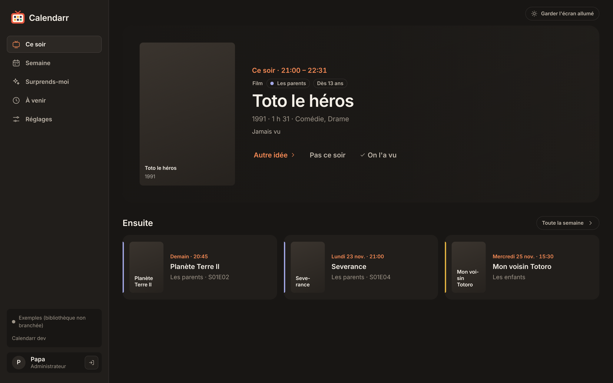
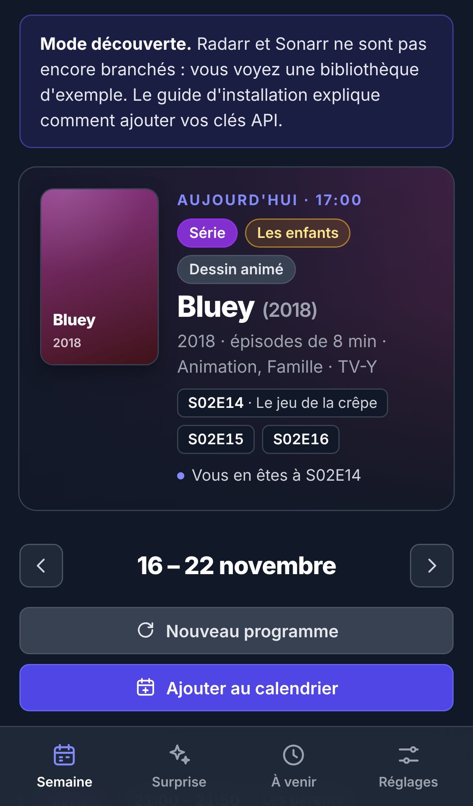

From 9c3d5362e31a2faba2db536ee5ce6e6ecdb5965f Mon Sep 17 00:00:00 2001
From: Claude <noreply@anthropic.com>
Date: Sun, 22 Nov 2026 00:10:26 +0100
Subject: [PATCH] =?UTF-8?q?Docs=20:=20README=20en=20anglais=20(README.md),?=
 =?UTF-8?q?=20version=20fran=C3=A7aise=20en=20README.fr.md?=
MIME-Version: 1.0
Content-Type: text/plain; charset=UTF-8
Content-Transfer-Encoding: 8bit

Co-Authored-By: Claude Sonnet 5.5 <noreply@anthropic.com>
Claude-Session: https://claude.ai/code/session_012RJfRQ4ousTUAjD7dhS2PT
---
 README.fr.md | 263 +++++++++++++++++++++++++++++++++++++++
 README.md    | 343 ++++++++++++++++++++++++++-------------------------
 2 files changed, 438 insertions(+), 168 deletions(-)
 create mode 100644 README.fr.md

diff --git a/README.fr.md b/README.fr.md
new file mode 100644
index 0000000..f6e6c25
--- /dev/null
+++ b/README.fr.md
@@ -0,0 +1,263 @@
+# Calendarr
+
+🇬🇧 [English version](README.md) · 🇫🇷 Version française (cette page)
+
+Le programme télé de la famille, construit à partir de votre arr stack.
+
+« Qu'est-ce qu'on regarde ce soir ? » Calendarr regarde ce qu'il y a dans votre bibliothèque (Radarr pour
+les films, Sonarr pour les séries) et ce que vous avez déjà vu (Jellyfin), puis il prépare le programme
+de la semaine. Il tient compte de l'heure à laquelle la soirée peut commencer et de l'âge des enfants, et
+le programme s'ajoute à votre calendrier iCloud.
+
+
+
+## Ce que fait Calendarr
+
+En ouvrant l'app, on tombe sur « Ce soir » : ce qu'on regarde maintenant, en grand, avec trois boutons.
+« ▶ Regarder » ouvre le titre dans Jellyfin (au bon épisode pour une série en cours), « Autre idée »
+propose autre chose, « Pas ce soir » le retire. Les trois programmes suivants sont juste en dessous.
+
+Pour chaque créneau de votre semaine type, par exemple « mercredi 15 h 30, les enfants, un film de
+1 h 30 maximum », Calendarr choisit un titre de la bibliothèque :
+
+- qui tient dans le créneau (pas de film de 2 h 30 un lundi à 21 h) ;
+- qui convient au public, d'après la classification du film ou de la série (G, PG, Tous publics, 12…) ;
+- jamais vu, ou pas depuis longtemps, d'après l'historique Jellyfin ;
+- pour une série, la suite de là où vous en êtes, un ou deux épisodes par soir. Les épisodes très courts,
+  comme les dessins animés, sont regroupés.
+
+Un jour sans créneau reste une soirée sans écran. C'est voulu : l'idée est de regarder moins, mais mieux.
+
+« Surprends-moi » propose des cartes à swiper. Vers la droite, le titre est programmé dans le prochain
+créneau qui lui convient ; vers la gauche, il ne reviendra plus ; vers le haut, il est marqué vu ; vers
+le bas, il reviendra dans deux semaines. Dans la pile « Pour nous deux », chacun swipe sur son compte, et
+quand vous dites oui tous les deux, le film est programmé.
+
+« À venir » liste les nouveaux épisodes (Sonarr) et les sorties de films (Radarr) des trois prochaines
+semaines. Le programme s'ajoute aussi à l'iPhone, au Mac, à Google Agenda ou à Outlook, avec un rappel
+15 minutes avant, et se met à jour tout seul.
+
+L'interface reprend l'esprit des apps *arr et de Seerr : thème sombre, menu latéral.
+
+| Surprends-moi | Sur téléphone |
+|---|---|
+|  |  |
+
+## Installation
+
+Calendarr est une image Docker (processeurs Intel/AMD et ARM). L'interface Docker de votre NAS suffit, pas
+besoin de terminal.
+
+| Image | Usage |
+|---|---|
+| `ghcr.io/frankless/calendarr:latest` | La dernière version stable, celle à utiliser. |
+| `ghcr.io/frankless/calendarr:0.1` | Rester sur la série 0.1. |
+| `ghcr.io/frankless/calendarr:edge` | La toute dernière modification, pour tester avant une version. |
+
+Les nouveautés de chaque version sont sur la page [Releases](https://github.com/Frankless/calendarr/releases).
+
+### 1. Créer le projet
+
+Dans l'interface Docker du NAS (UGOS : Docker → Projet → Créer ; Synology : Container Manager → Projet →
+Créer ; Portainer : Stacks → Add stack), collez le fichier [`docker-compose.yml`](docker-compose.yml) tel
+quel, puis lancez le projet.
+
+### 2. Ouvrir Calendarr
+
+Ouvrez `http://ADRESSE-DU-NAS:7979` dans le navigateur. Au premier lancement, Calendarr demande de créer
+le compte administrateur. Faites-le tout de suite : tant que ce compte n'existe pas, n'importe qui sur
+votre réseau peut le créer. L'app démarre ensuite avec une bibliothèque d'exemple.
+
+### 3. Brancher Radarr, Sonarr et Jellyfin
+
+Dans Réglages → Connexions, remplissez pour chaque service :
+
+| Champ | Où le trouver |
+|---|---|
+| Adresse | Celle que vous tapez pour ouvrir le service, par exemple `http://192.168.1.20:7878` pour Radarr, `:8989` pour Sonarr, `:8096` pour Jellyfin |
+| Clé API Radarr | Radarr → Settings → General → Security → API Key |
+| Clé API Sonarr | Sonarr → Settings → General → Security → API Key |
+| Clé API Jellyfin | Jellyfin → Tableau de bord → Clés API → + (appelez-la « Calendarr ») |
+| Utilisateur Jellyfin | À choisir dans la liste une fois la clé enregistrée ; son historique sert pour le « déjà vu » |
+
+« Enregistrer et tester » fait passer les pastilles au vert et refait le programme de la semaine avec
+votre vraie bibliothèque.
+
+Si les services tournent sur le même NAS, mettez l'adresse IP du NAS et pas `localhost` : pour Calendarr,
+`localhost` désigne son propre conteneur.
+
+Les clés restent sur le NAS, dans le dossier `config` du projet (fichier `connections.json`), avec vos
+réglages et vos programmes. L'app n'affiche jamais une clé en entier. Pour en changer, collez la nouvelle ;
+un champ laissé vide garde l'ancienne.
+
+### 4. Les comptes de la famille
+
+Dans Réglages → Comptes, l'administrateur crée un compte par personne. Chacun reste connecté 30 jours sur
+son appareil.
+
+| Rôle | Ce qu'il peut faire |
+|---|---|
+| Administrateur | Tout : connexions, comptes, famille, semaine type. |
+| Famille | Voir le programme, demander une autre idée, retirer ou programmer un titre, voir les sorties à venir, changer son mot de passe. |
+
+Chacun change son mot de passe dans « Mon compte », et l'administrateur peut en donner un nouveau à
+quelqu'un qui l'a oublié. Changer un mot de passe déconnecte les autres appareils du compte.
+
+Si c'est le mot de passe administrateur qui est perdu : arrêtez le projet, supprimez `config/users.json`,
+relancez. Calendarr redemande de créer le compte administrateur, et les réglages, connexions et programmes
+restent en place.
+
+### Avec un terminal
+
+```bash
+mkdir calendarr && cd calendarr
+curl -O https://raw.githubusercontent.com/Frankless/calendarr/main/docker-compose.yml
+docker compose up -d
+```
+
+### Dans le docker-compose de votre arr stack
+
+Copiez le bloc `calendarr:` du fichier `docker-compose.yml` sous `services:`. Si Calendarr est sur le même
+réseau Docker que les autres services, les adresses peuvent utiliser le nom des conteneurs, par exemple
+`http://radarr:7878`.
+
+Les variables `RADARR_URL`, `RADARR_API_KEY`, `SONARR_URL`, `SONARR_API_KEY`, `JELLYFIN_URL`,
+`JELLYFIN_API_KEY` et `JELLYFIN_USER` marchent aussi, mais ce qui est saisi dans l'app passe avant.
+
+## Sur l'iPhone et l'iPad
+
+Dans Safari, ouvrez Calendarr, touchez Partager, puis « Sur l'écran d'accueil ». Calendarr s'ouvre ensuite
+en plein écran, comme une app. Sur un iPad posé dans la cuisine, « Garder l'écran allumé » (page Ce soir)
+l'empêche de se mettre en veille.
+
+Pour que « ▶ Regarder » marche depuis le téléphone, l'adresse de Jellyfin doit être joignable depuis le
+téléphone. Si celle de Réglages → Connexions ne vaut que pour le NAS (`http://jellyfin:8096` par exemple),
+remplissez aussi « Adresse pour ouvrir Jellyfin depuis le téléphone ou l'iPad ».
+
+## Infuse sur l'Apple TV
+
+Dans Réglages → Regarder, choisissez comment la famille regarde :
+
+| Choix | Ce que fait le bouton |
+|---|---|
+| Jellyfin | « ▶ Regarder » ouvre le titre dans Jellyfin. |
+| Infuse sur le téléphone ou l'iPad | « ▶ Regarder » ouvre Infuse sur l'appareil, au bon film ou au bon épisode (à vérifier avec votre version d'Infuse). |
+| Infuse sur l'Apple TV | Une page web ne peut pas lancer un film sur l'Apple TV. Le bouton devient « Sur l'Apple TV » et indique où trouver le titre dans Infuse, avec l'épisode à lancer. |
+
+Avec l'option « Tenir à jour une collection de la semaine », Calendarr crée dans Jellyfin une collection
+« Calendarr · Semaine du 23 novembre » avec ce qui reste à voir cette semaine. Les jours passés en sortent,
+et le lundi la nouvelle collection remplace l'ancienne. Seule la collection est supprimée, jamais les
+films. Il n'y a donc jamais qu'une collection Calendarr à la fois ; évitez juste de nommer vous-même une
+collection « Calendarr · … ». Si Infuse est relié à votre Jellyfin, la collection apparaît dans Infuse
+avec les autres.
+
+## Écran de cuisine
+
+Réglages → Regarder donne aussi le lien de l'écran de cuisine. Ouvert sur une tablette murale, un écran
+d'assistant ou une télé, il affiche l'heure, « Ce soir » en grand et la suite, et se met à jour tout seul,
+en paysage comme en portrait. Il ne demande pas de connexion et ne permet de rien modifier. Le lien
+contient une clé secrète : si vous ne savez plus où il traîne, créez-en un nouveau, l'ancien cessera de
+marcher.
+
+## Le programme dans le calendrier de l'iPhone
+
+1. Sur l'iPhone, connecté au Wi-Fi de la maison, ouvrez Calendarr.
+2. Touchez « Ajouter à mon calendrier », puis « S'abonner sur cet appareil ».
+3. Confirmez. Le programme apparaît dans l'app Calendrier, avec un rappel 15 minutes avant.
+
+Faites de même sur le téléphone des autres membres de la famille.
+
+L'iPhone met le calendrier à jour lui-même, mais seulement quand il est à la maison. Pour qu'il se mette
+à jour ailleurs, ou pour l'ajouter depuis un Mac « dans iCloud », Calendarr doit être joignable depuis
+Internet. Le plus simple et le plus sûr est Tailscale, une app à installer sur le NAS et sur les
+téléphones. Si vous avez déjà un reverse proxy pour Jellyfin (Nginx Proxy Manager, Traefik, Caddy…),
+il fait aussi l'affaire : ajoutez alors `PUBLIC_URL: https://votre-adresse` dans la partie
+`environment:` du projet Docker.
+
+## Régler la semaine type
+
+
+
+Réglages permet de changer :
+
+- l'âge des enfants et l'âge conseillé maximum, 8 ans pour les soirées en famille et 6 pour les créneaux
+  enfants (à 7, un film « PG » passe, un « PG-13 » non) ;
+- le nombre d'épisodes par soirée, le délai avant de revoir un film, et le rappel ;
+- les genres aimés ou à éviter (touchez un genre une fois pour l'aimer, deux fois pour l'éviter) ;
+- la semaine type : pour chaque jour, des créneaux avec une heure, une durée maximum, un public (enfants,
+  famille, parents), un type (film, série, documentaire, peu importe) et un nom.
+
+La semaine type de départ :
+
+| Jour | Créneau |
+|---|---|
+| Lundi | 21 h, série pour les parents (60 min) |
+| Mardi | soirée sans écran |
+| Mercredi | 15 h 30, film pour les enfants (1 h 30) |
+| Jeudi | 21 h, « la grande première », film pour les parents (2 h 15) |
+| Vendredi | 18 h 30, film familial (1 h 45) |
+| Samedi | 17 h, dessin animé ; 21 h, soirée ciné (2 h 30) |
+| Dimanche | 20 h 45, documentaire (60 min) |
+
+Après un changement, « Enregistrer » refait la semaine suivante. Pour la semaine en cours, utilisez
+« Nouveau programme ».
+
+## Mettre à jour
+
+Dans l'interface Docker du NAS, arrêtez le projet, mettez l'image à jour (« Pull » ou « Mettre à jour »),
+puis relancez-le. En terminal : `docker compose pull && docker compose up -d`. L'image `latest` ne change
+qu'à la sortie d'une nouvelle version. Vos réglages et programmes restent dans le dossier `config/`.
+
+## En cas de souci
+
+| Problème | Solution |
+|---|---|
+| Pastille rouge « Injoignable » | L'adresse est fausse, ou le conteneur ne voit pas l'autre service. Essayez l'adresse IP du NAS plutôt que `localhost`. |
+| « Clé API refusée » | Recopiez la clé, sans espace au début ni à la fin. |
+| « Rien ne correspond » sur un créneau | Le créneau est trop court, l'âge maximum trop bas, ou tout a déjà été vu. Élargissez le créneau dans Réglages. |
+| Le NAS refuse de télécharger l'image (« unauthorized ») | Sur GitHub, ouvrez le paquet `calendarr` (onglet Packages de votre profil), puis Package settings → Change visibility → Public. |
+| Comprendre ce qui se passe | Le journal (« Logs ») du conteneur dans l'interface Docker, ou `docker logs calendarr`. |
+
+## Sécurité
+
+Les mots de passe font au moins 8 caractères et ne sont jamais stockés en clair. Après 5 erreurs depuis
+un même appareil, ou 20 sur un même compte, il faut attendre 5 minutes.
+
+Les clés API restent sur le NAS et ne repartent jamais en entier vers le navigateur. Si l'adresse d'un
+service change, sa clé est effacée et doit être saisie à nouveau, pour qu'elle ne parte jamais vers une
+autre adresse.
+
+Dans le conteneur, Calendarr ne tourne pas en root mais avec l'utilisateur `1000:1000`. Pour en choisir
+un autre, ajoutez `PUID` et `PGID` dans la partie `environment:` du projet.
+
+Derrière un reverse proxy, ajoutez `FORWARDED_ALLOW_IPS: <adresse IP du proxy>` dans `environment:`,
+pour que Calendarr voie l'adresse réelle des visiteurs. Sans proxy, n'ajoutez rien. Et ne publiez pas
+Calendarr sur Internet sans HTTPS ; Tailscale reste le plus simple.
+
+Pour signaler un problème de sécurité, ouvrez une issue sans détails techniques, ou contactez le
+propriétaire du dépôt.
+
+## Publier une nouvelle version
+
+Sur GitHub, onglet Actions → Image Docker → Run workflow, saisissez le numéro (par exemple `0.2.0`) et
+validez. Quelques minutes plus tard, l'image `latest` est à jour et la version apparaît dans Releases. Les
+notes de version se préparent dans `docs/releases/v0.2.0.md`.
+
+Les idées en cours et à venir sont dans [docs/backlog.md](docs/backlog.md).
+
+## Sous le capot
+
+- `app/clients.py` parle aux API de Radarr, Sonarr et Jellyfin.
+- `app/planner.py` contient les règles qui choisissent quoi regarder.
+- `app/feedback.py` garde en mémoire les choix faits dans « Surprends-moi ».
+- `app/ics.py` fabrique le calendrier.
+- `app/static/` contient l'interface : HTML, CSS et JavaScript, sans framework.
+
+Le tout tourne en Python 3.12 avec FastAPI, dans une seule image Docker.
+
+## À propos de ce projet
+
+Calendarr est fait par quelqu'un qui n'est pas développeur, avec l'aide d'une IA (Claude). Il tourne tous les
+jours sur mon propre NAS, mais aucun professionnel ne l'a audité. Relisez le code avant de l'exposer sur
+Internet, et gardez-le sur votre réseau local ou derrière un VPN.
+
diff --git a/README.md b/README.md
index 62ad342..6173784 100644
--- a/README.md
+++ b/README.md
@@ -1,111 +1,116 @@
 # Calendarr
 
-Le programme télé de la famille, construit à partir de votre arr stack.
+🇬🇧 English version (this page) · 🇫🇷 [Version française](README.fr.md)
 
-« Qu'est-ce qu'on regarde ce soir ? » Calendarr regarde ce qu'il y a dans votre bibliothèque (Radarr pour
-les films, Sonarr pour les séries) et ce que vous avez déjà vu (Jellyfin), puis il prépare le programme
-de la semaine. Il tient compte de l'heure à laquelle la soirée peut commencer et de l'âge des enfants, et
-le programme s'ajoute à votre calendrier iCloud.
+A family TV guide built from your *arr stack.
 
-
+"What are we watching tonight?" Calendarr looks at what is in your library (Radarr for movies, Sonarr for
+series) and what you have already watched (Jellyfin), then prepares the week's schedule. It takes into
+account the time the evening can start and the age of the children, and the schedule is added to your
+iCloud calendar.
 
-## Ce que fait Calendarr
+> The app's interface is in French for now. The screenshots below show the French interface.
 
-En ouvrant l'app, on tombe sur « Ce soir » : ce qu'on regarde maintenant, en grand, avec trois boutons.
-« ▶ Regarder » ouvre le titre dans Jellyfin (au bon épisode pour une série en cours), « Autre idée »
-propose autre chose, « Pas ce soir » le retire. Les trois programmes suivants sont juste en dessous.
+
 
-Pour chaque créneau de votre semaine type, par exemple « mercredi 15 h 30, les enfants, un film de
-1 h 30 maximum », Calendarr choisit un titre de la bibliothèque :
+## What Calendarr does
 
-- qui tient dans le créneau (pas de film de 2 h 30 un lundi à 21 h) ;
-- qui convient au public, d'après la classification du film ou de la série (G, PG, Tous publics, 12…) ;
-- jamais vu, ou pas depuis longtemps, d'après l'historique Jellyfin ;
-- pour une série, la suite de là où vous en êtes, un ou deux épisodes par soir. Les épisodes très courts,
-  comme les dessins animés, sont regroupés.
+Opening the app lands on "Ce soir" (Tonight): what you are watching now, shown big, with a few
+buttons. "Regarder" (Watch) opens the title in Jellyfin (at the right episode for a series in progress),
+"Autre idée" (Another idea) suggests something else, and "Pas ce soir" (Not tonight) removes it. The next
+three programs are right below.
 
-Un jour sans créneau reste une soirée sans écran. C'est voulu : l'idée est de regarder moins, mais mieux.
+For each slot of your typical week, for example "Wednesday 3:30 pm, the kids, a movie of 1 h 30 at most",
+Calendarr picks a title from the library:
 
-« Surprends-moi » propose des cartes à swiper. Vers la droite, le titre est programmé dans le prochain
-créneau qui lui convient ; vers la gauche, il ne reviendra plus ; vers le haut, il est marqué vu ; vers
-le bas, il reviendra dans deux semaines. Dans la pile « Pour nous deux », chacun swipe sur son compte, et
-quand vous dites oui tous les deux, le film est programmé.
+- that fits the slot (no 2 h 30 movie on a Monday at 9 pm);
+- that suits the audience, based on the movie's or series' rating (G, PG, Tous publics, 12…);
+- that you have never seen, or not for a long time, based on the Jellyfin history;
+- for a series, the next episode where you left off, one or two episodes per evening. Very short episodes,
+  such as cartoons, are grouped together.
 
-« À venir » liste les nouveaux épisodes (Sonarr) et les sorties de films (Radarr) des trois prochaines
-semaines. Le programme s'ajoute aussi à l'iPhone, au Mac, à Google Agenda ou à Outlook, avec un rappel
-15 minutes avant, et se met à jour tout seul.
+A day without a slot stays a screen-free evening. That is on purpose: the idea is to watch less, but better.
 
-L'interface reprend le style des apps *arr et de Seerr : thème sombre, accent indigo, menu latéral.
+"Surprends-moi" (Surprise me) offers cards to swipe. Swipe right and the title is scheduled in the next slot
+that suits it; swipe left and it will never come back; swipe up and it is marked as seen; swipe down and it
+comes back in two weeks. In the "Pour nous deux" (For the two of us) stack, each person swipes on their own
+account, and when you both say yes, the movie is scheduled.
 
-| Surprends-moi | Sur téléphone |
+"À venir" (Coming up) lists the new episodes (Sonarr) and movie releases (Radarr) of the next three weeks.
+The schedule can also be added to the iPhone, the Mac, Google Calendar or Outlook, with a reminder 15
+minutes before, and it updates itself.
+
+The interface follows the spirit of the *arr apps and Seerr: dark theme, side menu.
+
+| Surprise me | On a phone |
 |---|---|
-|  |  |
+|  |  |
 
 ## Installation
 
-Calendarr est une image Docker (processeurs Intel/AMD et ARM). L'interface Docker de votre NAS suffit, pas
-besoin de terminal.
+Calendarr is a Docker image (Intel/AMD and ARM processors). Your NAS's Docker interface is enough, no
+terminal needed.
 
-| Image | Usage |
+| Image | Use |
 |---|---|
-| `ghcr.io/frankless/calendarr:latest` | La dernière version stable, celle à utiliser. |
-| `ghcr.io/frankless/calendarr:0.1` | Rester sur la série 0.1. |
-| `ghcr.io/frankless/calendarr:edge` | La toute dernière modification, pour tester avant une version. |
+| `ghcr.io/frankless/calendarr:latest` | The latest stable version, the one to use. |
+| `ghcr.io/frankless/calendarr:0.1` | Stay on the 0.1 series. |
+| `ghcr.io/frankless/calendarr:edge` | The very latest change, to try before a release. |
 
-Les nouveautés de chaque version sont sur la page [Releases](https://github.com/Frankless/calendarr/releases).
+What is new in each version is on the [Releases](https://github.com/Frankless/calendarr/releases) page.
 
-### 1. Créer le projet
+### 1. Create the project
 
-Dans l'interface Docker du NAS (UGOS : Docker → Projet → Créer ; Synology : Container Manager → Projet →
-Créer ; Portainer : Stacks → Add stack), collez le fichier [`docker-compose.yml`](docker-compose.yml) tel
-quel, puis lancez le projet.
+In your NAS's Docker interface (UGOS: Docker → Project → Create; Synology: Container Manager → Project →
+Create; Portainer: Stacks → Add stack), paste the [`docker-compose.yml`](docker-compose.yml) file as it is,
+then start the project.
 
-### 2. Ouvrir Calendarr
+### 2. Open Calendarr
 
-Ouvrez `http://ADRESSE-DU-NAS:7979` dans le navigateur. Au premier lancement, Calendarr demande de créer
-le compte administrateur. Faites-le tout de suite : tant que ce compte n'existe pas, n'importe qui sur
-votre réseau peut le créer. L'app démarre ensuite avec une bibliothèque d'exemple.
+Open `http://NAS-ADDRESS:7979` in a browser. On first launch, Calendarr asks you to create the administrator
+account. Do it right away: until this account exists, anyone on your network can create it. The app then
+starts with a sample library.
 
-### 3. Brancher Radarr, Sonarr et Jellyfin
+### 3. Connect Radarr, Sonarr and Jellyfin
 
-Dans Réglages → Connexions, remplissez pour chaque service :
+In Réglages (Settings) → Connexions (Connections), fill in the following for each service:
 
-| Champ | Où le trouver |
+| Field | Where to find it |
 |---|---|
-| Adresse | Celle que vous tapez pour ouvrir le service, par exemple `http://192.168.1.20:7878` pour Radarr, `:8989` pour Sonarr, `:8096` pour Jellyfin |
-| Clé API Radarr | Radarr → Settings → General → Security → API Key |
-| Clé API Sonarr | Sonarr → Settings → General → Security → API Key |
-| Clé API Jellyfin | Jellyfin → Tableau de bord → Clés API → + (appelez-la « Calendarr ») |
-| Utilisateur Jellyfin | À choisir dans la liste une fois la clé enregistrée ; son historique sert pour le « déjà vu » |
+| Address | The one you type to open the service, for example `http://192.168.1.20:7878` for Radarr, `:8989` for Sonarr, `:8096` for Jellyfin |
+| Radarr API key | Radarr → Settings → General → Security → API Key |
+| Sonarr API key | Sonarr → Settings → General → Security → API Key |
+| Jellyfin API key | Jellyfin → Dashboard → API Keys → + (name it "Calendarr") |
+| Jellyfin user | Pick one from the list once the key is saved; their history is used for "already seen" |
 
-« Enregistrer et tester » fait passer les pastilles au vert et refait le programme de la semaine avec
-votre vraie bibliothèque.
+"Enregistrer et tester" (Save and test) turns the status dots green and rebuilds the week's schedule with
+your real library.
 
-Si les services tournent sur le même NAS, mettez l'adresse IP du NAS et pas `localhost` : pour Calendarr,
-`localhost` désigne son propre conteneur.
+If the services run on the same NAS, use the NAS's IP address and not `localhost`: for Calendarr,
+`localhost` means its own container.
 
-Les clés restent sur le NAS, dans le dossier `config` du projet (fichier `connections.json`), avec vos
-réglages et vos programmes. L'app n'affiche jamais une clé en entier. Pour en changer, collez la nouvelle ;
-un champ laissé vide garde l'ancienne.
+The keys stay on the NAS, in the project's `config` folder (the `connections.json` file), along with your
+settings and schedules. The app never shows a full key. To change one, paste the new one; a field left
+empty keeps the old one.
 
-### 4. Les comptes de la famille
+### 4. The family's accounts
 
-Dans Réglages → Comptes, l'administrateur crée un compte par personne. Chacun reste connecté 30 jours sur
-son appareil.
+In Réglages → Comptes (Accounts), the administrator creates one account per person. Each person stays
+signed in for 30 days on their device.
 
-| Rôle | Ce qu'il peut faire |
+| Role | What it can do |
 |---|---|
-| Administrateur | Tout : connexions, comptes, famille, semaine type. |
-| Famille | Voir le programme, demander une autre idée, retirer ou programmer un titre, voir les sorties à venir, changer son mot de passe. |
+| Administrateur (Administrator) | Everything: connections, accounts, family, typical week. |
+| Famille (Family) | See the schedule, ask for another idea, remove or schedule a title, see upcoming releases, change their own password. |
 
-Chacun change son mot de passe dans « Mon compte », et l'administrateur peut en donner un nouveau à
-quelqu'un qui l'a oublié. Changer un mot de passe déconnecte les autres appareils du compte.
+Everyone changes their password in "Mon compte" (My account), and the administrator can give a new one to
+someone who forgot theirs. Changing a password signs the account out of its other devices.
 
-Si c'est le mot de passe administrateur qui est perdu : arrêtez le projet, supprimez `config/users.json`,
-relancez. Calendarr redemande de créer le compte administrateur, et les réglages, connexions et programmes
-restent en place.
+If it is the administrator's password that is lost: stop the project, delete `config/users.json`, and start
+it again. Calendarr asks you to create the administrator account again, and your settings, connections and
+schedules stay in place.
 
-### Avec un terminal
+### With a terminal
 
 ```bash
 mkdir calendarr && cd calendarr
@@ -113,143 +118,145 @@ curl -O https://raw.githubusercontent.com/Frankless/calendarr/main/docker-compos
 docker compose up -d
 ```
 
-### Dans le docker-compose de votre arr stack
+### In your arr stack's docker-compose
 
-Copiez le bloc `calendarr:` du fichier `docker-compose.yml` sous `services:`. Si Calendarr est sur le même
-réseau Docker que les autres services, les adresses peuvent utiliser le nom des conteneurs, par exemple
+Copy the `calendarr:` block from the `docker-compose.yml` file under `services:`. If Calendarr is on the
+same Docker network as your other services, the addresses can use container names, for example
 `http://radarr:7878`.
 
-Les variables `RADARR_URL`, `RADARR_API_KEY`, `SONARR_URL`, `SONARR_API_KEY`, `JELLYFIN_URL`,
-`JELLYFIN_API_KEY` et `JELLYFIN_USER` marchent aussi, mais ce qui est saisi dans l'app passe avant.
+The variables `RADARR_URL`, `RADARR_API_KEY`, `SONARR_URL`, `SONARR_API_KEY`, `JELLYFIN_URL`,
+`JELLYFIN_API_KEY` and `JELLYFIN_USER` also work, but what is entered in the app takes priority.
 
-## Sur l'iPhone et l'iPad
+## On the iPhone and iPad
 
-Dans Safari, ouvrez Calendarr, touchez Partager, puis « Sur l'écran d'accueil ». Calendarr s'ouvre ensuite
-en plein écran, comme une app. Sur un iPad posé dans la cuisine, « Garder l'écran allumé » (page Ce soir)
-l'empêche de se mettre en veille.
+In Safari, open Calendarr, tap Share, then "Add to Home Screen". Calendarr then opens full screen, like an
+app. On an iPad sitting in the kitchen, "Garder l'écran allumé" (Keep the screen on, on the Tonight page)
+stops it from going to sleep.
 
-Pour que « ▶ Regarder » marche depuis le téléphone, l'adresse de Jellyfin doit être joignable depuis le
-téléphone. Si celle de Réglages → Connexions ne vaut que pour le NAS (`http://jellyfin:8096` par exemple),
-remplissez aussi « Adresse pour ouvrir Jellyfin depuis le téléphone ou l'iPad ».
+For "Regarder" to work from a phone, the Jellyfin address must be reachable from the phone. If the one in
+Réglages → Connexions only works from the NAS (`http://jellyfin:8096`, for example), also fill in "Adresse
+pour ouvrir Jellyfin depuis le téléphone ou l'iPad" (Address to open Jellyfin from the phone or iPad).
 
-## Infuse sur l'Apple TV
+## Infuse on Apple TV
 
-Dans Réglages → Regarder, choisissez comment la famille regarde :
+In Réglages → Regarder (Watch), choose how the family watches:
 
-| Choix | Ce que fait le bouton |
+| Choice | What the button does |
 |---|---|
-| Jellyfin | « ▶ Regarder » ouvre le titre dans Jellyfin. |
-| Infuse sur le téléphone ou l'iPad | « ▶ Regarder » ouvre Infuse sur l'appareil, au bon film ou au bon épisode (à vérifier avec votre version d'Infuse). |
-| Infuse sur l'Apple TV | Une page web ne peut pas lancer un film sur l'Apple TV. Le bouton devient « Sur l'Apple TV » et indique où trouver le titre dans Infuse, avec l'épisode à lancer. |
+| Jellyfin | "Regarder" opens the title in Jellyfin. |
+| Infuse on the phone or iPad | "Regarder" opens Infuse on the device, at the right movie or episode (check with your version of Infuse). |
+| Infuse on Apple TV | A web page cannot start a movie on the Apple TV. The button becomes "Sur l'Apple TV" and tells you where to find the title in Infuse, with the episode to play. |
 
-Avec l'option « Tenir à jour une collection de la semaine », Calendarr crée dans Jellyfin une collection
-« Calendarr · Semaine du 23 novembre » avec ce qui reste à voir cette semaine. Les jours passés en sortent,
-et le lundi la nouvelle collection remplace l'ancienne. Seule la collection est supprimée, jamais les
-films. Il n'y a donc jamais qu'une collection Calendarr à la fois ; évitez juste de nommer vous-même une
-collection « Calendarr · … ». Si Infuse est relié à votre Jellyfin, la collection apparaît dans Infuse
-avec les autres.
+With the "keep a weekly collection up to date" option, Calendarr creates in Jellyfin a collection named
+"Calendarr · Semaine du 23 novembre" (week of November 23) with what is left to watch this week. Past days
+drop out of it, and on Monday the new collection replaces the old one. Only the collection is deleted,
+never the movies. So there is only ever one Calendarr collection at a time; just avoid naming a collection
+"Calendarr · …" yourself. If Infuse is linked to your Jellyfin, the collection shows up in Infuse with the
+others.
 
-## Écran de cuisine
+## Kitchen screen
 
-Réglages → Regarder donne aussi le lien de l'écran de cuisine. Ouvert sur une tablette murale, un écran
-d'assistant ou une télé, il affiche l'heure, « Ce soir » en grand et la suite, et se met à jour tout seul,
-en paysage comme en portrait. Il ne demande pas de connexion et ne permet de rien modifier. Le lien
-contient une clé secrète : si vous ne savez plus où il traîne, créez-en un nouveau, l'ancien cessera de
-marcher.
+Réglages → Regarder also gives the kitchen screen link. Opened on a wall tablet, a smart display or a TV,
+it shows the time, "Ce soir" big, and what comes next, and updates itself, in landscape or portrait. It
+asks for no login and cannot change anything. The link contains a secret key: if you no longer know where
+it is lying around, create a new one and the old one will stop working.
 
-## Le programme dans le calendrier de l'iPhone
+## The schedule in the iPhone calendar
 
-1. Sur l'iPhone, connecté au Wi-Fi de la maison, ouvrez Calendarr.
-2. Touchez « Ajouter à mon calendrier », puis « S'abonner sur cet appareil ».
-3. Confirmez. Le programme apparaît dans l'app Calendrier, avec un rappel 15 minutes avant.
+1. On the iPhone, connected to your home Wi-Fi, open Calendarr.
+2. Tap "Ajouter à mon calendrier" (Add to my calendar), then "S'abonner sur cet appareil" (Subscribe on
+   this device).
+3. Confirm. The schedule appears in the Calendar app, with a reminder 15 minutes before.
 
-Faites de même sur le téléphone des autres membres de la famille.
+Do the same on the other family members' phones.
 
-L'iPhone met le calendrier à jour lui-même, mais seulement quand il est à la maison. Pour qu'il se mette
-à jour ailleurs, ou pour l'ajouter depuis un Mac « dans iCloud », Calendarr doit être joignable depuis
-Internet. Le plus simple et le plus sûr est Tailscale, une app à installer sur le NAS et sur les
-téléphones. Si vous avez déjà un reverse proxy pour Jellyfin (Nginx Proxy Manager, Traefik, Caddy…),
-il fait aussi l'affaire : ajoutez alors `PUBLIC_URL: https://votre-adresse` dans la partie
-`environment:` du projet Docker.
+The iPhone updates the calendar by itself, but only when it is at home. For it to update elsewhere, or to add
+it from a Mac "in iCloud", Calendarr must be reachable from the Internet. The simplest and safest way is
+Tailscale, an app to install on the NAS and on the phones. If you already have a reverse proxy for Jellyfin
+(Nginx Proxy Manager, Traefik, Caddy…), it works too: then add `PUBLIC_URL: https://your-address` in the
+project's `environment:` section.
 
-## Régler la semaine type
+## Setting up the typical week
 
-
+
 
-Réglages permet de changer :
+Réglages lets you change:
 
-- l'âge des enfants et l'âge conseillé maximum, 8 ans pour les soirées en famille et 6 pour les créneaux
-  enfants (à 7, un film « PG » passe, un « PG-13 » non) ;
-- le nombre d'épisodes par soirée, le délai avant de revoir un film, et le rappel ;
-- les genres aimés ou à éviter (touchez un genre une fois pour l'aimer, deux fois pour l'éviter) ;
-- la semaine type : pour chaque jour, des créneaux avec une heure, une durée maximum, un public (enfants,
-  famille, parents), un type (film, série, documentaire, peu importe) et un nom.
+- the children's age and the maximum recommended age, 8 for family evenings and 6 for kids' slots (at 7, a
+  "PG" movie passes, a "PG-13" does not);
+- the number of episodes per evening, the delay before watching a movie again, and the reminder;
+- liked or avoided genres (tap a genre once to like it, twice to avoid it);
+- the typical week: for each day, slots with a time, a maximum duration, an audience (kids, family,
+  parents), a type (movie, series, documentary, any) and a name.
 
-La semaine type de départ :
+The starting typical week:
 
-| Jour | Créneau |
+| Day | Slot |
 |---|---|
-| Lundi | 21 h, série pour les parents (60 min) |
-| Mardi | soirée sans écran |
-| Mercredi | 15 h 30, film pour les enfants (1 h 30) |
-| Jeudi | 21 h, « la grande première », film pour les parents (2 h 15) |
-| Vendredi | 18 h 30, film familial (1 h 45) |
-| Samedi | 17 h, dessin animé ; 21 h, soirée ciné (2 h 30) |
-| Dimanche | 20 h 45, documentaire (60 min) |
+| Monday | 9 pm, series for the parents (60 min) |
+| Tuesday | screen-free evening |
+| Wednesday | 3:30 pm, movie for the kids (1 h 30) |
+| Thursday | 9 pm, "the big premiere", movie for the parents (2 h 15) |
+| Friday | 6:30 pm, family movie (1 h 45) |
+| Saturday | 5 pm, cartoon; 9 pm, movie night (2 h 30) |
+| Sunday | 8:45 pm, documentary (60 min) |
 
-Après un changement, « Enregistrer » refait la semaine suivante. Pour la semaine en cours, utilisez
-« Nouveau programme ».
+After a change, "Enregistrer" (Save) rebuilds the following week. For the current week, use "Nouveau
+programme" (New schedule).
 
-## Mettre à jour
+## Updating
 
-Dans l'interface Docker du NAS, arrêtez le projet, mettez l'image à jour (« Pull » ou « Mettre à jour »),
-puis relancez-le. En terminal : `docker compose pull && docker compose up -d`. L'image `latest` ne change
-qu'à la sortie d'une nouvelle version. Vos réglages et programmes restent dans le dossier `config/`.
+In your NAS's Docker interface, stop the project, update the image ("Pull" or "Update"), then start it
+again. In a terminal: `docker compose pull && docker compose up -d`. The `latest` image only changes when a
+new version is released. Your settings and schedules stay in the `config/` folder.
 
-## En cas de souci
+## Troubleshooting
 
-| Problème | Solution |
+| Problem | Solution |
 |---|---|
-| Pastille rouge « Injoignable » | L'adresse est fausse, ou le conteneur ne voit pas l'autre service. Essayez l'adresse IP du NAS plutôt que `localhost`. |
-| « Clé API refusée » | Recopiez la clé, sans espace au début ni à la fin. |
-| « Rien ne correspond » sur un créneau | Le créneau est trop court, l'âge maximum trop bas, ou tout a déjà été vu. Élargissez le créneau dans Réglages. |
-| Le NAS refuse de télécharger l'image (« unauthorized ») | Sur GitHub, ouvrez le paquet `calendarr` (onglet Packages de votre profil), puis Package settings → Change visibility → Public. |
-| Comprendre ce qui se passe | Le journal (« Logs ») du conteneur dans l'interface Docker, ou `docker logs calendarr`. |
+| Red "Injoignable" (Unreachable) dot | The address is wrong, or the container cannot see the other service. Try the NAS's IP address instead of `localhost`. |
+| "Clé API refusée" (API key refused) | Copy the key again, without a space at the start or end. |
+| "Rien ne correspond" (Nothing matches) on a slot | The slot is too short, the maximum age too low, or everything has already been seen. Widen the slot in Réglages. |
+| The NAS refuses to pull the image ("unauthorized") | On GitHub, open the `calendarr` package (Packages tab of your profile), then Package settings → Change visibility → Public. |
+| Understanding what is going on | The container's log ("Logs") in the Docker interface, or `docker logs calendarr`. |
+
+## Security
+
+Passwords are at least 8 characters long and are never stored in clear text. After 5 mistakes from the same
+device, or 20 on the same account, you have to wait 5 minutes.
 
-## Sécurité
+The API keys stay on the NAS and never go back in full to the browser. If a service's address changes, its
+key is erased and must be entered again, so that it never goes to another address.
 
-Les mots de passe font au moins 8 caractères et ne sont jamais stockés en clair. Après 5 erreurs depuis
-un même appareil, ou 20 sur un même compte, il faut attendre 5 minutes.
+Inside the container, Calendarr does not run as root but as user `1000:1000`. To choose another one, add
+`PUID` and `PGID` in the project's `environment:` section.
 
-Les clés API restent sur le NAS et ne repartent jamais en entier vers le navigateur. Si l'adresse d'un
-service change, sa clé est effacée et doit être saisie à nouveau, pour qu'elle ne parte jamais vers une
-autre adresse.
+Behind a reverse proxy, add `FORWARDED_ALLOW_IPS: <the proxy's IP address>` in `environment:`, so that
+Calendarr sees visitors' real addresses. Without a proxy, add nothing. And do not publish Calendarr on the
+Internet without HTTPS; Tailscale remains the simplest option.
 
-Dans le conteneur, Calendarr ne tourne pas en root mais avec l'utilisateur `1000:1000`. Pour en choisir
-un autre, ajoutez `PUID` et `PGID` dans la partie `environment:` du projet.
+To report a security problem, open an issue without technical details, or contact the repository owner.
 
-Derrière un reverse proxy, ajoutez `FORWARDED_ALLOW_IPS: <adresse IP du proxy>` dans `environment:`,
-pour que Calendarr voie l'adresse réelle des visiteurs. Sans proxy, n'ajoutez rien. Et ne publiez pas
-Calendarr sur Internet sans HTTPS ; Tailscale reste le plus simple.
+## Publishing a new version
 
-Pour signaler un problème de sécurité, ouvrez une issue sans détails techniques, ou contactez le
-propriétaire du dépôt.
+On GitHub, Actions tab → Image Docker → Run workflow, enter the number (for example `0.2.0`) and confirm. A
+few minutes later, the `latest` image is up to date and the version appears under Releases. Release notes
+are prepared in `docs/releases/v0.2.0.md`.
 
-## Publier une nouvelle version
+Ideas in progress and to come are in [docs/backlog.md](docs/backlog.md).
 
-Sur GitHub, onglet Actions → Image Docker → Run workflow, saisissez le numéro (par exemple `0.2.0`) et
-validez. Quelques minutes plus tard, l'image `latest` est à jour et la version apparaît dans Releases. Les
-notes de version se préparent dans `docs/releases/v0.2.0.md`.
+## Under the hood
 
-Les idées en cours et à venir sont dans [docs/backlog.md](docs/backlog.md).
+- `app/clients.py` talks to the Radarr, Sonarr and Jellyfin APIs.
+- `app/planner.py` holds the rules that choose what to watch.
+- `app/feedback.py` remembers the choices made in "Surprends-moi".
+- `app/ics.py` builds the calendar.
+- `app/static/` holds the interface: HTML, CSS and JavaScript, no framework.
 
-## Sous le capot
+It all runs on Python 3.12 with FastAPI, in a single Docker image.
 
-- `app/clients.py` parle aux API de Radarr, Sonarr et Jellyfin.
-- `app/planner.py` contient les règles qui choisissent quoi regarder.
-- `app/feedback.py` garde en mémoire les choix faits dans « Surprends-moi ».
-- `app/ics.py` fabrique le calendrier.
-- `app/static/` contient l'interface : HTML, CSS et JavaScript, sans framework. La police Inter vient de
-  Google Fonts quand Internet est disponible.
+## About this project
 
-Le tout tourne en Python 3.12 avec FastAPI, dans une seule image Docker.
+Calendarr is built by a non-developer with the help of an AI (Claude). It runs daily on my own NAS, but it
+has not been audited by a professional. Please read the code before exposing it to the internet, and keep it
+on your home network or behind a VPN.
-- 
2.43.0
